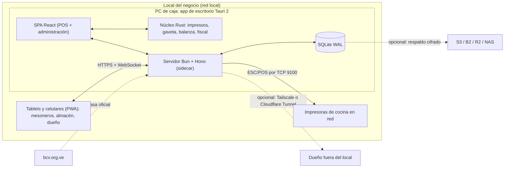
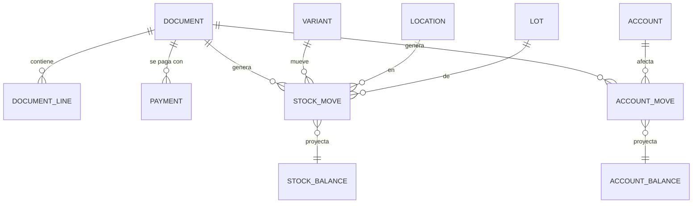

# Millhiore WINK POS: plan de producto y arquitectura

> Sistema administrativo y punto de venta **open source y autohospedado** para comercios en Venezuela, pensado como competencia directa de [Wink POS](https://wink-pos.com).
> Nombre de trabajo; ver [Riesgos](#16-riesgos-y-decisiones-abiertas) sobre la marca.
>
> Estado: v2 · 25 de octubre de 2026. Las fases 1, 2 y 3 están completas en el código; lo hecho y lo que falta está en [Avance](#avance-al-24-de-octubre-de-2026).

## Índice

1. [Resumen](#1-resumen)
2. [Wink POS como referencia](#2-wink-pos-como-referencia)
3. [Principios](#3-principios)
4. [Arquitectura](#4-arquitectura)
5. [Stack recomendado](#5-stack-recomendado)
6. [Modelo de dominio](#6-modelo-de-dominio)
7. [Módulos funcionales](#7-módulos-funcionales)
8. [Hardware e impresión](#8-hardware-e-impresión)
9. [Personalización y extensibilidad](#9-personalización-y-extensibilidad)
10. [Fiabilidad, seguridad y respaldos](#10-fiabilidad-seguridad-y-respaldos)
11. [Rendimiento](#11-rendimiento)
12. [Estructura del repositorio](#12-estructura-del-repositorio)
13. [Calidad, CI y distribución](#13-calidad-ci-y-distribución)
14. [Hoja de ruta](#14-hoja-de-ruta)
15. [Comunidad y licencia](#15-comunidad-y-licencia)
16. [Riesgos y decisiones abiertas](#16-riesgos-y-decisiones-abiertas)
17. [Fuentes](#17-fuentes)

---

## 1. Resumen

Un POS que iguala lo que hace Wink POS y añade lo que un SaaS no puede dar: **funciona sin internet, los datos viven en el equipo del negocio, habla directo con el hardware y cualquiera puede modificarlo**.

| | |
|---|---|
| **Lenguaje** | TypeScript de punta a punta (Rust solo para hardware) |
| **Servidor** | Bun + Hono + SQLite (Drizzle ORM) |
| **Web / PWA** | React 19 + Vite 8 + TanStack Router/Query + Tailwind CSS 4 + shadcn/ui |
| **Escritorio (caja)** | Tauri 2 con el servidor embebido como sidecar |
| **Despliegue por defecto** | Se instala la app en la PC de la caja; ella misma es el servidor. Tablets y celulares se conectan por la red local escaneando un QR |

Wink POS ya es gratis y ya calcula IVA e IGTF, así que **no competimos en precio ni en impuestos**. Competimos en propiedad de los datos, operación sin internet, hardware, facturación fiscal y apertura.

---

## 2. Wink POS como referencia

Wink POS (de Wink / Yummy Inc.) es una app web gratuita para restaurantes, tiendas de ropa y bodegas en Venezuela. Requiere internet para vender y no emite facturas fiscales. Su promesa central: *"ningún número de inventario o de saldo cambia sin un documento detrás"*. La adoptamos como principio de diseño.

La tabla se actualizó el 15 de octubre de 2026 recorriendo la app de Wink (app.wink-pos.com) con un comercio de prueba. **Hoy** indica lo que Millhiore ya hace (revisado el 24 de octubre de 2026, al cerrar la fase 2): ✅ hecho, 🔶 en parte, — pendiente.

| Funcionalidad | Wink POS | Millhiore (plan) | Fase | Hoy |
|---|---|---|---|---|
| **Caja** | | | | |
| Ventas con vuelto | ✅ | ✅ | 1 | ✅ |
| Pagos mixtos (USD efectivo + pago móvil + punto…) | ✅ un cobro por cuenta | ✅ | 1 | ✅ |
| Vuelto en otra moneda u otro método | moneda elegida | ✅ cualquier moneda y método | 1 | ✅ |
| Lector de códigos y búsqueda | ✅ | ✅ sin enfocar ningún campo | 1 | ✅ |
| Varias ventas abiertas a la vez y dividir cuenta | ✅ pestañas + mover productos entre cuentas | ✅ ventas en espera + dividir | 1 / 3 | 🔶 ventas en espera |
| Descuentos | ✅ códigos (% o monto, usos máximos, vigencia), uno por venta | ✅ por línea y por venta con permiso, y códigos | 1–2 | ✅ por línea y por venta con el permiso `sale.discount`, y códigos (% o monto, usos máximos, vigencia) que aplica cualquier cajero |
| Recargos (delivery, servicio de mesonero) | ✅ fijos o %, al cliente o como costo interno | ✅ | 2 | ✅ fijos o %, con su IVA, que se activan en la caja (además del IGTF por método de pago) |
| Cotizaciones | ✅ | ✅ | 2 | ✅ con vigencia, envío por WhatsApp y conversión en venta |
| Nota de la venta | ✅ | ✅ | 1 | — |
| Modo caja (oculta el menú) | ✅ | ✅ | 1 | — |
| **Monedas e impuestos** | | | | |
| Dólares y bolívares | ✅ tasa BCV automática + manual + día de referencia | ✅ BCV automática con fuentes de respaldo + manual + historial | 0 | ✅ |
| Moneda principal por comercio y por usuario | ✅ | ✅ | 1 | 🔶 solo por comercio |
| IVA por producto | ✅ 16 % y exento | ✅ alícuotas configurables, precio con IVA incluido o no | 0–1 | ✅ |
| IGTF | ✅ 3 % al cobrar en divisas | ✅ por método de pago, según la condición ante el SENIAT | 1 | ✅ |
| **Turnos y finanzas** | | | | |
| Caja con cierre por turno | ✅ (se activa aparte) | ✅ + arqueo por denominación, ingresos y retiros | 1 | ✅ |
| Cierre del día para compartir (texto para WhatsApp) | ✅ | ✅ | 1 | ✅ |
| Cuentas (efectivo, banco, pago móvil) | ✅ con saldo inicial | ✅ | 1 | ✅ pantalla «Cuentas»: saldos, crear, renombrar y desactivar |
| Comisión por cuenta al recibir y al enviar (punto, pago móvil) | ✅ | ✅ | 2 | ✅ al cobrar ventas y abonos (por método de pago); al enviar queda como gasto aparte |
| Transferencias entre cuentas | ✅ con comisión | ✅ | 2 | ✅ con cambio de moneda; su comisión se registra como gasto aparte |
| Exposición cambiaria (cuánto valen hoy en USD los bolívares guardados) | ✅ | ✅ | 2 | ✅ en Cuentas, por cuenta en bolívares: lo que valían al entrar contra lo que valen hoy |
| Gastos con categorías, pendientes y recurrentes | ✅ | ✅ | 2 | ✅ al contado o a deber, con categorías editables y recurrentes |
| Venta a crédito (fiado) con abonos y días de crédito | ✅ | ✅ + límite de deuda, deuda en dólares, recordatorio por WhatsApp | 1 | ✅ |
| CxC y CxP, incluidos pendientes manuales | ✅ | ✅ + antigüedad de saldos | 2 | ✅ fiado y por pagar con antigüedad de saldos, y deudas anotadas a mano (saldos de antes y préstamos) |
| Comisiones al equipo (mesoneros, vendedores) | ✅ | ✅ | 3 | — |
| **Catálogo e inventario** | | | | |
| Productos y servicios, unidad, SKU, código de barras, existencia mínima | ✅ | ✅ | 1 | ✅ |
| Categorías | ✅ con color y orden | ✅ | 1 | ✅ con orden manual, filtro en Productos y chips en la caja |
| Canales de venta con precio propio y cambio masivo de precios | ✅ | ✅ listas de precios (detal, mayor, delivery) | 2 | ✅ listas de precios (también por cliente) y cambio masivo de precios |
| Compras a proveedores | ✅ con forma de pago, cuenta y nº de factura | ✅ | 1 | ✅ |
| Salidas con motivo (merma, uso interno) y ajustes por conteo | ✅ | ✅ + conteo físico desde el celular | 2 | ✅ motivos editables y valor a costo; conteo físico desde el celular, con la cámara o el lector |
| Devoluciones de clientes y a proveedores | ✅ | ✅ | 1–2 | ✅ devolución parcial de ventas (reembolso o descuento de la deuda) y a proveedores (reembolso o descuento de lo que se le debe) |
| Inventario por ubicación y traslados | ✅ (se activa aparte) | ✅ | 2 | ✅ varias ubicaciones y cajas, traslados al instante (se activa aparte); falta la confirmación de recepción |
| Lotes con costo y vencimiento | ✅ (se activa aparte) | ✅ FEFO/FIFO + alertas | 2 | ✅ vencimiento por lote, FEFO automático y avisos (se activa aparte); el costo sigue siendo el último, por decisión de la usuaria |
| Variantes (talla y color) | ✅ | ✅ en matriz + etiquetas con código de barras | 3 | ✅ hasta tres características con su cuadrícula en la caja y en las compras, y etiquetas con código de barras en rollo u hoja |
| Recetas y producción que descuenta insumos | ✅ | ✅ + porcentaje de merma | 3 | ✅ recetas con merma que descuentan los insumos al vender el plato y le dan su costo, y producción por tandas que gasta los ingredientes y deja el costo de lo producido |
| Salas, mesas y cuentas abiertas | ✅ | ✅ + comandas y pantalla de cocina (KDS) | 3 | ✅ salas y mesas, cuentas abiertas que se pasan de mesa o se juntan, precuenta, cobro total, por productos o a partes iguales, rol de mesonero, opciones y extras, comandas a la impresora de cada estación o a la pantalla de cocina con tiempos, y propina por mesonero |
| **Informes y datos** | | | | |
| Inicio: hoy, el mes y lo que requiere atención | ✅ | ✅ | 1 | ✅ |
| Informes de resultados, ventas, inventario y finanzas | ✅ con comparación contra el período anterior | ✅ + libro de ventas para el contador | 2 | ✅ resultados (utilidad), ventas (también por categoría), inventario valorado, finanzas y libro de IVA de ventas y compras, comparados con el período anterior |
| Exportar a Excel y PDF | ✅ | ✅ | 2 | ✅ cada informe a Excel y a impresión o PDF |
| Importar desde Excel (catálogo, contactos, existencias, compras, ventas) | ✅ | ✅ con vista previa de errores por fila | 2 | 🔶 productos (con existencias) y contactos (con saldos), con vista previa fila por fila; faltan compras y ventas |
| **Equipo y configuración** | | | | |
| Roles | 4 fijos con matriz de permisos | 4 de fábrica + personalizados + PIN de supervisor | 0–1 | 🔶 6 de fábrica (también mesonero y cocina) y PIN de cajero; falta el PIN de supervisor |
| Contraseñas y sesiones | invitación por correo, ver y cerrar sesiones | cuentas locales; cambiar, restablecer y recuperar desde el servidor | 1 | ✅ (falta la lista de sesiones) |
| Bitácora | ✅ de cambios de configuración | ✅ de toda acción sensible | 1 | ✅ pantalla en Ajustes con filtros, y sesiones activas que se pueden cerrar |
| Datos del negocio y del recibo | ✅ título, campos visibles, vista previa | ✅ | 1 | ✅ (falta la vista previa) |
| Recibos 58 mm / 80 mm / carta / PDF | ✅ | ✅ + impresión ESC/POS directa + gaveta | 1 | 🔶 térmico y navegador; falta carta y PDF |
| Funciones que se activan según el tipo de negocio | ✅ perfil + 8 funciones; apagarlas oculta sin borrar datos | ✅ | 1–3 | ✅ por tipo de negocio (bodega, tienda, ropa, comida, mayorista), con tallas y colores y mesas |
| Guía «para arrancar» | ✅ 7 pasos | ✅ | 1 | ✅ asistente inicial y siete pasos en Inicio que se marcan solos |
| Modo oscuro | ✅ | ✅ | 0 | ✅ |
| Resumen diario por correo | ✅ | por Telegram (opcional, requiere internet) | 4 | ✅ resumen del día y alertas por Telegram |
| **Lo que Wink no tiene** | | | | |
| **Funciona sin internet** | ❌ | ✅ en la red local | 1 | ✅ |
| **Datos en tu equipo, respaldos propios** | ❌ | ✅ | 1 | ✅ |
| **App de escritorio con instalador** | ❌ | ✅ | 1 | ✅ Windows |
| **Impresión directa en térmica y gaveta** | no especificado | ✅ | 1 | ✅ |
| Escaneo con la cámara del celular | no especificado | ✅ | 2 | ✅ en la caja, productos, compras, traslados y conteo; sin HTTPS, con una foto |
| Balanza y códigos con peso | no especificado | ✅ | 4 | ✅ venta por kilo, litro o metro, etiquetas de la balanza con peso o precio y lectura por el puerto serie |
| **API pública y webhooks** | ❌ | ✅ | 4 | ✅ API REST documentada (OpenAPI) con claves por alcance y webhooks firmados con reintentos |
| Varias sucursales | ✅ en su nube | ✅ un servidor central; luego sincronización entre servidores | 4–5 | ✅ contra un servidor, o cada una con su servidor sincronizado con el central: inventario, cajas, turnos, personal, precios e informes por sucursal |
| **Facturación fiscal SENIAT** | ❌ | 🔶 adaptador desacoplado, según la normativa vigente | 5 | — |
| **Código abierto** | ❌ | ✅ MIT | — | ✅ |

Ideas de Wink que adoptamos:

- **Funciones activables:** cada comercio enciende solo lo que usa (mesas, cierre de caja, crédito, ubicaciones, lotes, recetas, variantes, comisiones). Apagarlas oculta la función sin borrar datos. Encaja con el asistente por tipo de negocio.
- **Cierre del día como texto** listo para copiar o mandar por WhatsApp al dueño.
- **Comisiones por cuenta:** el punto de venta y el pago móvil cobran un porcentaje. La venta queda pagada por el monto bruto y la comisión va a gastos, así la utilidad es real.
- **Exposición cambiaria:** muestra cuánto se devaluaron los bolívares guardados, sin tocar los saldos.
- **Utilidad completa:** ventas netas sin IVA − costo de lo vendido − gastos − comisiones − pérdidas de inventario. Las mermas y los vencidos son pérdida; la devolución a proveedor y el uso interno no.

---

## 3. Principios

1. **Local primero.** El negocio vende aunque se caiga internet. Internet solo hace falta para cosas opcionales: tasa automática, acceso remoto y respaldo en la nube.
2. **Documento → libro.** Nadie edita una existencia ni un saldo directamente. Cada documento contabilizado (venta, compra, ajuste, traslado, gasto, abono) genera movimientos inmutables en dos libros: **inventario** y **dinero**. Los saldos son proyecciones de esos libros. Un error se corrige con un documento de reverso, nunca con un `UPDATE`.
3. **Dinero exacto.** Los montos se guardan como enteros (céntimos) y las tasas como decimal de 8 cifras. El redondeo es explícito por moneda. Cada documento guarda la tasa con la que se hizo.
4. **Rápido en equipos modestos.** Debe ir bien en una PC con Windows 10 y 4 GB de RAM y en un Android de gama baja.
5. **Abierto por diseño.** Todo lo que hace la interfaz lo hace también la API. Se puede exportar todo, siempre.
6. **Sin telemetría por defecto.**

---

## 4. Arquitectura



La **misma SPA** corre en todos lados. Si detecta que está dentro de Tauri, usa el puente de hardware nativo. En un navegador, usa WebUSB/WebSerial cuando están disponibles.

### Modos de despliegue

| Modo | Para quién | Cómo |
|---|---|---|
| **Todo en uno** (por defecto) | Bodega o tienda con 1–2 cajas | Instalador `.msi` / `.deb` / `.AppImage` / `.dmg`. El servidor corre dentro de la app |
| **Servidor dedicado** | Restaurante con varias cajas, varias sucursales | Binario único como servicio de Windows (WinSW) o systemd, o imagen Docker amd64/arm64, en un mini‑PC, Raspberry Pi 5 o VPS. Las cajas usan la app en modo cliente o el navegador |
| **Demo / desarrollo** | Comunidad | `docker compose up` con datos de ejemplo por tipo de negocio |

### Por qué un servidor en la red local y no sincronización en cada dispositivo

Con el servidor dentro del local, una caída de internet no afecta las ventas, porque todo el tráfico va por la red local. Eso resuelve el caso offline más común sin un motor de sincronización entre dispositivos, que es la parte más difícil y propensa a errores de un POS. Para el caso restante (un dispositivo que pierde la red local) hay una cola de salida en el cliente en la fase 4. Como los documentos son inmutables y sus ids se generan en el cliente, esa cola no produce conflictos.

### HTTPS en la red local

El service worker (PWA instalable), la cámara y WebUSB exigen contexto seguro. La caja Tauri usa `localhost`, que ya cuenta como seguro, así que no le afecta. Para tablets y celulares hay dos opciones:

- **CA local:** el servidor genera su propia autoridad certificadora la primera vez y un certificado para su IP o nombre. Cada dispositivo instala la CA una sola vez escaneando un QR.
- **Tailscale:** certificados HTTPS válidos en `*.ts.net`, sin instalar ninguna CA. De paso da acceso remoto seguro.

Sin HTTPS todo funciona en el navegador, pero no se puede instalar la PWA ni escanear con la cámara.

### Tiempo real

El servidor empuja eventos por WebSocket a los clientes: pedidos a cocina, estado de mesas, cambios de existencias y de tasa. Los clientes invalidan la caché de TanStack Query al recibirlos.

---

## 5. Stack recomendado

### Servidor

| Pieza | Elección | Por qué |
|---|---|---|
| Runtime | **Bun** | SQLite nativo y muy rápido (`bun:sqlite`). Compila a **un solo ejecutable** para Windows, Linux y macOS. Trae test runner y hash Argon2 |
| HTTP | **Hono 4** | Ligero y rápido, con WebSocket en Bun y tipado de extremo a extremo con el cliente (`hono/client`). Portable a Node si Bun diera problemas |
| Validación | **Zod 4** | Los mismos esquemas en servidor y web |
| Documentación de API | **@hono/zod-openapi + Scalar** | OpenAPI generado desde los mismos esquemas, con documentación interactiva en `/api/docs` |
| Base de datos | **SQLite** en modo WAL con `synchronous=FULL` | Cero configuración, un archivo y respaldo trivial; sobra para decenas de terminales. `FULL` por los cortes de luz |
| ORM y migraciones | **Drizzle ORM + drizzle-kit** | SQL explícito y tipado, migraciones versionadas en el repo. Usar la 0.45.x estable y pasar a 1.0 cuando salga de beta |
| Autenticación | **Better Auth** | Sesiones, usuario y contraseña, control de acceso. Plugin propio para PIN de cajero |
| Tareas programadas | **croner** | Tasa BCV, gastos recurrentes, respaldos, alertas de vencimiento y de stock |
| Logs | **LogTape** con archivo rotado | JSON estructurado, sin dependencias, funciona dentro del binario compilado |
| Decimales | **big.js** | Conversiones con tasa y redondeo controlado (los montos se guardan como enteros) |
| Identificadores | **UUIDv7** | Ordenables por tiempo y generables en el cliente, lo que da idempotencia y modo offline |

### Web (POS y administración)

| Pieza | Elección | Por qué |
|---|---|---|
| Base | **React 19 + Vite 8** (Rolldown) | SPA servida por el propio servidor. No hace falta SSR: es una app detrás de login |
| Rutas | **TanStack Router** | Rutas y search params tipados (filtros de informes), carga diferida por módulo |
| Datos | **TanStack Query** | Caché, reintentos e invalidación por WebSocket |
| Tablas | **TanStack Table + TanStack Virtual** | Catálogos e informes de miles de filas sin trabarse |
| Formularios | **React Hook Form + Zod** | Maduro y bien integrado con shadcn/ui |
| UI | **Tailwind CSS 4 + shadcn/ui** | Los componentes viven en el repo y se modifican sin pelear con una librería. Temas por variables CSS |
| Íconos y animación | **lucide + Motion** | Íconos consistentes y microinteracciones sobrias |
| Gráficos | **Recharts** (charts de shadcn) | Coherente con el resto del sistema de diseño |
| Paleta de comandos | **cmdk** | `Ctrl+K` para buscar productos, clientes, documentos y acciones |
| Avisos | **sonner** | |
| Estado de la caja | **Zustand** persistido | El carrito y los pagos en curso sobreviven a una recarga o a un corte |
| Catálogo offline | **Dexie** (IndexedDB) **+ MiniSearch** | Búsqueda instantánea y por código de barras sin ir al servidor |
| PWA | **vite-plugin-pwa** (Workbox) | Instalable y con los assets en caché |
| Idiomas | **Paraglide JS** | Mensajes compilados y tipados. `es-VE` por defecto, `en` para la comunidad |
| Fechas | **date-fns + @date-fns/tz** | Zona `America/Caracas` y hora de corte del día configurable (restaurantes que cierran después de medianoche) |
| Tipografía | **Inter o Geist vía Fontsource** | Las fuentes van empaquetadas; no dependen de Google Fonts sin internet |
| PDF | **@react-pdf/renderer** | Recibos carta y documentos como componentes React. Se generan en el navegador y se comparten por WhatsApp con Web Share |
| Excel | **ExcelJS** | Importación con vista previa de errores y exportación con formato |
| Cámara | **barcode-detector** (polyfill zxing-wasm) | Escaneo de códigos desde el celular |

### Escritorio y hardware

| Pieza | Elección | Por qué |
|---|---|---|
| Shell | **Tauri 2** | Usa el WebView2 del sistema (mucho más liviano que Electron) y trae actualizaciones firmadas |
| Servidor embebido | Binario de Bun como **sidecar** | El mismo servidor que en modo dedicado |
| Bytes ESC/POS | **@point-of-sale/receipt-printer-encoder** | Genera texto, códigos de barras, QR, imágenes y páginas de códigos para cientos de impresoras |
| Transporte | Rust: spooler de Windows (RAW), USB, serial, TCP 9100 | Impresión y apertura de gaveta sin diálogos |
| Serial | crate **serialport** | Balanzas e impresoras fiscales |
| Sin Tauri | **WebUSB / WebSerial** (drivers `@point-of-sale/*`) | Imprimir desde Chrome en escritorio o Android |

### Herramientas de desarrollo

- **Monorepo:** Bun workspaces + Turborepo.
- **Lint y formato:** Biome.
- **TypeScript estricto:** `strict` y `noUncheckedIndexedAccess`.
- **Tests:**
  - `bun test` para dominio y servidor, contra SQLite real en memoria.
  - **fast-check** para tests basados en propiedades.
  - **Vitest + Testing Library** para la web.
  - **Playwright** para flujos completos.
- **Diseño:** **Penpot** (open source), para prototipar junto con la comunidad.
- **Documentación:** **Starlight** (Astro).
- **Releases:** Changesets → GitHub Releases. `tauri-action` genera los instaladores y la imagen Docker se publica en GHCR.

### Descartado

| Opción | Motivo |
|---|---|
| Next.js / Astro para la app | El SSR no aporta nada detrás de un login y complica el binario único. Astro sí sirve para la documentación |
| PostgreSQL por defecto | Obliga a instalar y administrar otro servicio en la PC del negocio. Se puede añadir después para despliegues grandes |
| Electron | Pesa más y consume más RAM; Tauri usa el WebView del sistema |
| Backend en Rust o Go | Más rápidos en bruto, pero el cuello de botella de un POS no es la CPU. TypeScript compartido entre web y servidor evita errores y atrae más colaboradores. Rust queda donde sí rinde: el hardware |
| Motores de sync (ElectricSQL, PowerSync, Zero, Replicache) | Añaden un servicio y un modelo propio. Con servidor en la red local y documentos inmutables, alcanza con una cola de salida propia |

---

## 6. Modelo de dominio

### Los dos libros



**Contabilización de un documento.** Todo ocurre en una sola transacción SQLite:

1. Validar el documento: esquema Zod, reglas de dominio y permisos.
2. Asignar número en su serie, por terminal (ej.: `C1-000123`).
3. Insertar la cabecera, las líneas y los pagos.
4. Generar `stock_move` y `account_move`. El consumo de recetas se incluye aquí y el lote se elige por FEFO o FIFO.
5. Actualizar las proyecciones `stock_balance` y `account_balance`.
6. Escribir en `audit_log` y emitir un evento en `outbox`, que alimenta los webhooks, el WebSocket y la sincronización.

Si algo falla, no se escribe nada. Como el id del documento lo genera el cliente (UUIDv7), reintentar es seguro.

### Entidades

| Área | Tablas |
|---|---|
| Negocio | `business`, `location` (tienda, almacén, cocina), `terminal`, `setting` |
| Acceso | `user`, `role`, `permission`, `user_location`, `session`, `api_key` |
| Monedas | `currency` (USD, VES, EUR, USDT…), `exchange_rate` (fecha efectiva, fuente `bcv`/`manual`, valor, autor) |
| Catálogo | `category`, `product` (bien, servicio, receta, insumo, combo), `variant` (SKU, código de barras, atributos, precio y su moneda), `option` / `option_value` (talla, color), `price_list` (detal, mayor), `recipe_item` (insumo, cantidad, % merma), `modifier_group` / `modifier`, `tax` (IVA general, reducido, exento), `payment_surcharge` (p. ej. IGTF por método de pago, configurable) |
| Inventario | `lot` (costo, vencimiento, proveedor), `stock_move`, `stock_balance`, `stock_count` |
| Documentos | `document` (tipo, serie, número, estado, moneda, tasa, totales, contacto, terminal, turno), `document_line`, `payment` (método, cuenta, moneda, monto, tasa, referencia), `allocation` (qué abono paga qué documento) |
| Finanzas | `account` (caja USD, caja Bs, banco, pago móvil, Zelle, Binance), `payment_method` (cuenta, moneda, si exige referencia), `account_move`, `account_balance`, `cash_shift` (apertura, esperado, contado por denominación, diferencia), `recurring_expense` |
| Restaurante | `dining_area`, `dining_table`, `order` (cuenta abierta), `order_line`, `kitchen_ticket` |
| Contactos | `contact` (cliente o proveedor; cédula o RIF con validación del dígito verificador; límite de crédito) |
| Sistema | `audit_log`, `outbox`, `attachment`, `webhook`, `discount_code`, `custom_field` |

Tipos de documento: `SALE`, `RETURN`, `PURCHASE`, `TRANSFER`, `ADJUSTMENT`, `EXPENSE`, `PAYMENT_IN`, `PAYMENT_OUT`, `CASH_IN`, `CASH_OUT`.

### Dinero y tasas

- Cada monto se guarda como `amount_minor INTEGER` más su `currency`. Las cantidades van en milésimas (`qty_milli`) para vender por peso.
- La tasa se guarda como decimal de 8 cifras (como la publica el BCV) y se opera con big.js.
- Hay una moneda de referencia (normalmente USD) y una moneda legal (VES). Cada documento guarda su moneda, la tasa usada y los totales en ambas.
- El total en Bs se calcula sobre el total del documento, no sumando líneas ya redondeadas; así no aparecen céntimos fantasma.
- El redondeo se define por moneda y por método (el efectivo en Bs puede redondear a múltiplos).
- El vuelto es un pago negativo y puede ir en otra moneda y por otro método. Ejemplo: el cliente paga 20 USD en efectivo y recibe el vuelto en Bs por pago móvil.
- Costeo: lotes por FEFO (perecederos) o FIFO. Los productos sin lotes usan un lote implícito con costo promedio ponderado.

### Invariantes

Se verifican con tests basados en propiedades (fast-check) y con una tarea nocturna de auditoría:

1. `stock_balance` = Σ `stock_move` por (variante, ubicación, lote).
2. `account_balance` = Σ `account_move` por cuenta.
3. No existe ningún movimiento sin documento.
4. Un documento contabilizado es inmutable; anularlo genera un documento de reverso.
5. En cada venta, Σ pagos − vuelto + lo fiado = total, con tolerancia de redondeo por moneda. Lo que se debe de una venta es lo fiado menos los abonos aplicados, y cada abono reparte exactamente su total entre las ventas que paga.
6. En cada cierre de turno, esperado = apertura + entradas − salidas, por moneda y por cuenta.

---

## 7. Módulos funcionales

**Caja (POS)**
- Pantalla en tres zonas: búsqueda y catálogo con categorías, ticket, y cobro.
- Atajos de teclado: `F2` buscar, `F4` cliente, `F12` cobrar, `Esc` cancelar. También es táctil, con botones grandes.
- El lector USB se detecta por la velocidad de tecleo, sin enfocar ningún campo.
- Billetes rápidos en USD y Bs, pagos mixtos y vuelto calculado.
- Ventas en espera, reimpresión y bloqueo de pantalla con cambio de cajero por PIN.
- Cotizaciones que luego se convierten en venta; nota de la venta; canal de venta (detal, mayor, delivery) con su lista de precios.
- Modo caja a pantalla completa, sin el menú lateral.
- Siempre visibles: la tasa del día, el precio en ambas monedas y el estado de la conexión con el servidor.

**Restaurante**
- Plano de mesas por área y cuentas abiertas.
- Dividir la cuenta por ítems o en partes iguales; mover y unir mesas.
- Comandas a la impresora de cocina o al KDS, con tiempos de preparación.
- Propina.

**Catálogo**
- Productos y servicios, variantes en matriz, recetas y modificadores.
- Listas de precios.
- Actualización masiva de precios (por porcentaje o al cambiar la tasa).
- Etiquetas con código de barras.

**Inventario**
- Existencias por ubicación y lotes.
- Entradas (compras), salidas, ajustes con motivo y traslados con confirmación de recepción.
- Conteo físico desde el celular.
- Alertas de mínimo y de vencimiento; kardex por producto.

**Finanzas**
- Cuentas, turnos de caja e ingresos y retiros de caja.
- Comisión por cuenta al recibir y al enviar; transferencias entre cuentas con su comisión.
- Gastos con categorías, pagados al momento o pendientes, y gastos recurrentes que generan un pendiente al vencer.
- Fiado: venta a crédito con días de crédito y límite de deuda por cliente, y abonos que se aplican a lo más antiguo. La deuda se lleva en dólares (en bolívares se devalúa) aunque la factura sea en bolívares. Un abono es un documento `PAYMENT_IN` con sus asignaciones (`allocation`); anularlo devuelve la deuda, y una venta con abonos no se anula hasta anular antes sus abonos.
- CxC y CxP con antigüedad de saldos, incluidos pendientes que no vienen de una venta o compra; flujo de caja.
- Exposición cambiaria de los saldos en bolívares.

**Informes**
- Inicio con el resumen del día, el del mes y lo que requiere atención (existencia baja, cobros y pagos vencidos).
- Cierre del día en texto para copiar o enviar por WhatsApp.
- Resultados: de las ventas a la utilidad (costo, gastos, comisiones, pérdidas de inventario), capital a la fecha y comparación con el período anterior.
- Ventas por día, hora (mapa de horas pico), producto, categoría, canal, cliente, cajero y método de pago; más y menos vendidos con margen.
- Inventario valorizado a costo y a precio de venta, bajo mínimo, por vencer, rotación con días restantes, mermas por motivo y cierres mensuales.
- Finanzas: saldos por cuenta, entradas y salidas, gastos por categoría, antigüedad de CxC/CxP y turnos cerrados con diferencia.
- Libro de ventas para el contador.
- Todo se exporta a Excel y PDF.

**Contactos:** clientes y proveedores (o ambos), cédula o RIF, teléfono, correo, dirección, días de crédito, historial y saldo.

**Configuración**
- Asistente inicial por tipo de negocio (restaurante, ropa, bodega) que activa las funciones correspondientes, prueba la impresora e importa el catálogo desde Excel.
- Funciones activables una por una; apagar una la oculta sin borrar sus datos.
- Guía «para arrancar» en Inicio con los pasos pendientes.
- Bitácora visible de los cambios de configuración y las acciones sensibles.

---

## 8. Hardware e impresión

| Dispositivo | Cómo | Fase |
|---|---|---|
| Impresora térmica 58/80 mm (USB, serial, red) | `receipt-printer-encoder` → Tauri (RAW, USB, serial, TCP) o WebUSB/WebSerial | 1 |
| Gaveta de dinero | Pulso ESC/POS a través de la impresora | 1 |
| Lector de códigos USB | Modo teclado, detección por ráfaga | 1 |
| Cámara del celular | `barcode-detector` (zxing-wasm) | 2 |
| Impresora de cocina en red | El servidor envía ESC/POS por TCP 9100 | 3 |
| Etiquetas | TSPL/ZPL o plantilla en hoja carta | 3 (✅ por el navegador: rollo con el controlador de la impresora u hoja carta/A4; falta TSPL/ZPL directo) |
| Balanza / EAN‑13 con peso (prefijo 2x) | Serial vía Tauri; decodificación del código | 4 |
| Impresora fiscal | Adaptador `FiscalProvider` (p. ej. protocolo de The Factory HKA por serial) | 5 |

Los formatos carta y PDF se generan con `@react-pdf/renderer` o con la impresión del navegador.

**Hecho:** térmica de 58 y 80 mm y gaveta, con `packages/printing` (ESC/POS propio, página de códigos PC850, sin dependencias). El servidor imprime por TCP 9100, por una impresora compartida de Windows o por un dispositivo, y también queda el diálogo del navegador. Solo se probó contra una impresora de red simulada; falta probarlo con una térmica real y con una USB compartida. El lector de códigos USB ya funciona sin enfocar ningún campo.

---

## 9. Personalización y extensibilidad

- **Temas:** tokens de shadcn en variables CSS. Presets y editor visual (colores, radio, tipografía, logo), modos claro, oscuro y alto contraste, y densidad táctil o compacta.
- **Plantillas de recibo:** bloques configurables con vista previa en vivo (logo, encabezado, datos fiscales, QR, mensaje de pie, columnas visibles), por tamaño de papel.
- **Campos personalizados** en productos, contactos y documentos.
- **Permisos granulares** (`sale.discount`, `sale.void`, `cost.view`, `inventory.adjust`…) y aprobación con PIN de supervisor según umbrales (descuento mayor a X %, anulaciones).
- **API REST** documentada (OpenAPI) con API keys por alcance, y **webhooks firmados** (HMAC) con reintentos: `sale.posted`, `stock.low`, `shift.closed`, `rate.updated`…
- **Plugins** (fase 5, hecho): paquetes que registran rutas, tareas, eventos y una pantalla; corren aislados (QuickJS en WebAssembly) con los permisos que se les dan, sobre la API y los eventos que ya existen.
- **Integraciones candidatas a plugin:** alertas al dueño por Telegram, catálogo público y pedidos por WhatsApp, conciliación de pago móvil.

---

## 10. Fiabilidad, seguridad y respaldos

**Integridad**
- SQLite en WAL con `synchronous=FULL`; se recomienda UPS en la caja.
- Una transacción por documento, e idempotencia por el id que genera el cliente.
- Antes de cada migración se hace un respaldo; las migraciones se aplican solas al arrancar.

**Respaldos**
- Instantánea automática (`VACUUM INTO`) a diario y en cada cierre de turno, con rotación.
- En modo servidor, réplica continua opcional con Litestream hacia S3, B2, R2 o un NAS.
- Todo respaldo que sale del equipo va cifrado. Se restaura desde la interfaz.
- `PRAGMA integrity_check` periódico.
- Exportación completa a Excel o JSON en cualquier momento: cero lock‑in.

**Seguridad**
- Argon2id para contraseñas y PIN; cookies `httpOnly` + `SameSite`.
- Los permisos se verifican **en el servidor**, nunca solo en la UI.
- Límite de intentos de login y de PIN.
- Auditoría de toda acción sensible: anulaciones, descuentos, ajustes, cambios de precio y de tasa.
- API keys guardadas como hash.
- Acceso remoto con Tailscale (recomendado) o Cloudflare Tunnel; nunca abrir puertos en el router.

**Actualizaciones:** updater firmado de Tauri e imagen Docker versionada, con canales estable y beta.

---

## 11. Rendimiento

El tamaño del bundle y las métricas del servidor se miden en CI.

| Métrica | Objetivo |
|---|---|
| Buscar un producto entre 20 000 SKUs | < 30 ms en el cliente |
| Registrar una venta en la red local | < 100 ms p95 |
| Arranque del POS en Android de gama baja (con caché) | < 2 s |
| JavaScript inicial de la ruta POS | < 250 KB gzip (la administración se carga aparte) |
| RAM del servidor en reposo | < 150 MB |
| Equipo mínimo | Windows 10 de 64 bits con 4 GB; Raspberry Pi 5 o mini‑PC para servidor dedicado |

---

## 12. Estructura del repositorio

```
Millhiore_WINK/
├─ apps/
│  ├─ server/          Bun + Hono: API REST/WS, tareas, sirve la SPA
│  ├─ web/             React + Vite: POS y administración (PWA)
│  └─ desktop/         Tauri 2: caja, sidecar del servidor, hardware
├─ packages/
│  ├─ domain/          reglas puras: dinero, tasas, impuestos, totales, permisos
│  ├─ db/              esquema Drizzle, migraciones, seeds por tipo de negocio
│  ├─ contracts/       esquemas Zod compartidos y OpenAPI
│  ├─ ui/              sistema de diseño (shadcn + tokens + temas)
│  ├─ printing/        plantillas ESC/POS y PDF
│  ├─ bcv/             obtención de la tasa oficial (reutilizable, MIT)
│  └─ i18n/            mensajes es-VE / en
├─ docs/               Starlight
├─ docker/
└─ .github/workflows/
```

```
apps/server/src/
├─ main.ts
├─ app.ts
├─ modules/            auth · catalog · inventory · sales · restaurant
│  │                   finance · contacts · reports · settings · rates
│  └─ <módulo>/        routes.ts · service.ts · repo.ts · schemas.ts
├─ posting/            motor documento → libros
├─ jobs/               tasa BCV, recurrentes, respaldos, alertas
├─ realtime/           WebSocket y bus de eventos
└─ infra/              db, logger, config, backups, tls

apps/web/src/
├─ routes/             TanStack Router, un archivo por ruta (pos/, admin/…)
├─ features/<módulo>/  componentes, hooks y queries
└─ lib/                cliente de API, puente de hardware, almacén offline

apps/desktop/src-tauri/src/
└─ printer.rs · serial.rs · sidecar.rs
```

`packages/domain` no conoce la base de datos ni HTTP. Es lógica pura que se usa igual en el servidor y en el navegador, y es lo más testeado del proyecto.

---

## 13. Calidad, CI y distribución

- **Flujos críticos en Playwright:**
  - venta con pago mixto y vuelto en otra moneda;
  - cierre de turno con diferencia;
  - devolución;
  - traslado entre ubicaciones;
  - venta a crédito y abono.
- **CI con GitHub Actions:**
  - Biome, `tsc` y tests;
  - control del tamaño del bundle;
  - instaladores Tauri para Windows, Linux y macOS;
  - imagen Docker multi‑arquitectura en GHCR;
  - documentación.
- **Versionado:** SemVer con Changesets y notas en español e inglés.
- **Demo pública** que se reinicia cada noche, con datos de ejemplo para bodega, ropa y restaurante.

---

## 14. Hoja de ruta

| Fase | Contenido | Lista cuando… |
|---|---|---|
| **0. Cimientos** | Monorepo y CI, sistema de diseño y temas, autenticación y roles, configuración, monedas y tasa BCV automática, asistente inicial, motor de contabilización con sus invariantes | Se instala, se crean el negocio y los usuarios, y la tasa se actualiza sola |
| **1. MVP bodega/tienda** | Catálogo simple con categorías, existencias (una ubicación), POS con pagos mixtos, vuelto y descuentos, fiado con abonos, turnos y cierre, recibos térmicos y gaveta, contactos, resumen y cierre del día, respaldos automáticos, app de escritorio todo en uno | Una bodega real opera una semana completa sin cuaderno |
| **2. Paridad de gestión** | Varias ubicaciones y traslados, lotes FEFO/FIFO, salidas con motivo, conteo físico, CxC/CxP, cuentas con comisiones y transferencias, gastos y recurrentes, devoluciones, cotizaciones, códigos de descuento, recargos, listas de precios, Excel, PDF, cámara, informes completos, funciones activables | Iguala a Wink salvo restaurante y ropa |
| **3. Verticales** | Restaurante (mesas, cuentas abiertas, recetas, modificadores, comandas, KDS) y ropa (matriz de variantes, etiquetas) | Paridad completa con Wink |
| **4. Más allá de Wink** | Cola offline en clientes, balanza, API pública y webhooks, HTTPS local con QR, acceso remoto guiado, varias sucursales contra un servidor, alertas por Telegram | |
| **5. Ecosistema** | Adaptador fiscal SENIAT según la normativa vigente, sincronización entre servidores de sucursales, plugins, catálogo público y pedidos por WhatsApp | |

Recomendación: **publicar al terminar la fase 1**, con una bodega piloto real. Esperar a tener la paridad completa retrasa demasiado la opinión de usuarios reales.

### Avance al 24 de octubre de 2026

CI en verde: Biome, `tsc`, 699 pruebas y compilación de la web. **La fase 2 está completa** (24-oct-2026). De la fase 3 ya está **ropa** (tallas y colores, y etiquetas) y, de restaurante, **las mesas con cuentas abiertas**, **las opciones y extras**, **las comandas a cocina**, **las recetas**, **la producción por tandas** y **la propina por mesonero**: **restaurante está completo** (25-oct-2026). De la **fase 4** ya están la venta por peso con balanza, la API pública con claves, los webhooks, las alertas por Telegram, HTTPS en la red local, el acceso remoto guiado, la cola offline en la caja y las sucursales: **la fase 4 está completa** (25-oct-2026). De la **fase 5** ya están el catálogo en línea con fotos, los pedidos por WhatsApp desde el catálogo, los plugins, las sucursales con servidor propio y lo que se puede preparar de la factura sin la norma técnica: **la fase 5 está completa hasta donde lo permite la ley** (25-oct-2026).

**Fase 0, completa**
- Monorepo con Bun workspaces y Turborepo; CI con `bun run ci` y GitHub Actions.
- Sistema de diseño (shadcn/ui + tokens), tema claro y oscuro, y uso en el celular (360–440 px sin desbordes).
- Autenticación con Better Auth y Argon2id, y 4 roles de fábrica (dueño, administrador, cajero, almacenista) con permisos verificados en el servidor.
- Contraseñas por tres vías: la propia, el restablecimiento por el dueño (temporal y cambio obligatorio) y la recuperación desde la consola del servidor.
- Monedas y tasa BCV automática con fuentes de respaldo, carga manual e historial.
- Impuestos y recargos configurables: alícuotas de IVA, precio con IVA incluido (por defecto), IGTF por método de pago y condición ante el SENIAT.
- Asistente inicial y motor de contabilización (documento → libros de inventario y dinero) con sus invariantes probados.

**Fase 1, hecho**
- Caja: búsqueda y lector de códigos sin foco, pagos mixtos, vuelto en otra moneda o método, ventas en espera, recibo e impresión automática.
- Turnos: apertura, ingresos y retiros, y cierre con arqueo por billete y reporte.
- Productos con existencia y existencia mínima; ajustes de existencia.
- Compras a proveedores (adelantado de la fase 2).
- **Fiado** (16-oct-2026): fiar el resto de una venta a un cliente registrado, pantalla «Fiado» con lo que debe cada cliente, estado de cuenta, cobro de abonos (en cualquier método y moneda, con IGTF si corresponde), días de crédito y límite de deuda por cliente, recordatorio por WhatsApp, y permisos `sale.credit` y `payment.receive`. Se puede apagar en Ajustes. Sale en el recibo, el cierre de turno, el resumen del día y Inicio.
- **Categorías** (16-oct-2026): categorías con orden manual, selector en el producto, filtro en Productos y chips en la caja.
- **Descuentos** (16-oct-2026): por producto y por toda la venta (% o monto), con el permiso `sale.discount`; el descuento de la venta se reparte entre las líneas y queda en recibos, informes y cierre.
- **Cierre del día** (16-oct-2026): texto listo para copiar o mandar por WhatsApp desde Inicio.
- **PIN de cajero y bloqueo de pantalla** (16-oct-2026): PIN de 4 a 6 dígitos (Argon2id, sin repetidos ni secuencias, 5 errores bloquean 5 minutos), bloqueo manual y por inactividad configurable; restablecer la contraseña borra el PIN.
- **Devolución parcial** (16-oct-2026): desde el detalle de una venta, por producto y cantidad, con el precio, el descuento y el IVA con que se vendió. El dinero se reembolsa en el método que se elija o se descuenta de lo que el cliente todavía debe. Repone existencias, sale en el recibo (serie `DV`), el cierre de turno, el resumen del día y el cierre para WhatsApp. Una venta con devoluciones vigentes no se anula.
- **Bitácora y sesiones** (16-oct-2026): pantalla de la bitácora en Ajustes (permiso `audit.view`, con filtros por fecha, tipo de acción y búsqueda) y lista de sesiones activas, propias o de todos (`user.manage`), que se pueden cerrar.
- Contactos (clientes y proveedores) con cédula o RIF.
- Historial de ventas y anulación con documento de reverso.
- Inicio con el resumen del día y la existencia baja.
- Datos del negocio y del recibo configurables por cada comercio.
- Respaldos diarios y manuales, descarga, restauración al reiniciar y respaldo antes de cada migración.
- Impresión térmica ESC/POS (58 y 80 mm) y gaveta.
- App de escritorio Tauri 2 con el servidor como sidecar e instalador NSIS para Windows.
- API REST documentada con OpenAPI (`/api/docs`).
- Licencia MIT.

**Falta para cerrar la fase 1** (en orden)
1. Probar con una impresora térmica real y con una USB compartida en Windows.
2. Firmar el instalador (hoy Windows muestra el aviso de SmartScreen).
3. Negocio piloto y las dudas para el contador (base del IGTF, retenciones, factura fiscal, y si una devolución debe reembolsar el IGTF: hoy no lo reembolsa).

**Quedó para después** (no bloquea la fase 1)
- Cambio rápido de cajero con PIN y aprobación de supervisor con PIN (descuentos grandes, anulaciones): el PIN de hoy solo desbloquea la pantalla de quien ya entró.
- Vales o notas de crédito a favor del cliente (hoy se reembolsa o se descuenta de la deuda).

**Fase 2, hecho**
- **Exposición cambiaria** (24-oct-2026): tarjeta en **Cuentas** (`GET /api/accounts/exposure`, la ven quienes ven las cuentas) con cada cuenta en bolívares que tiene saldo: lo que valían en dólares cuando entraron, lo que valen hoy a la tasa vigente y la diferencia (en rojo si se devaluaron), con el total. La base es un **promedio móvil**: lo que entra suma su valor a la tasa de ese momento (del historial de tasas) y lo que sale se lleva su parte proporcional; si el saldo pasa de positivo a negativo, la base vuelve a empezar. Es informativa: no toca los saldos ni la utilidad.
- **Devoluciones a proveedores** (24-oct-2026): «Devolver al proveedor» en el detalle de una compra (permiso `purchase.void`), por producto y cantidad, con el costo y el IVA con que se compró. Es el documento nuevo `PURCHASE_RETURN` (serie `DC`): saca la mercancía de la ubicación a la que entró la compra (de los lotes que trajo esa compra y lo que falte del que vence primero) y el proveedor **reembolsa** por el método que se elija (en efectivo exige turno abierto) o se **descuenta de lo que se le debe** de esa compra. Sale en Compras (restando), en el comprobante («DEVOLUCIÓN A PROVEEDOR», «Reembolso del proveedor»), en el libro de compras con signo negativo, en el total de compras de Inicio y Resultados y en el reporte de turno. Una compra con devoluciones vigentes no se anula hasta anularlas. Nuevas invariantes: la devolución es de una compra y no devuelve más de lo comprado.
- **Códigos de descuento** (24-oct-2026): Productos → Más → **Códigos de descuento** (permiso `sale.discount`): código (PROMO10), porcentaje o monto fijo en $ o Bs, usos máximos y vigencia opcionales, y nota; se editan y desactivan, y la bitácora los registra. En la caja, «Código de descuento» lo valida (`/api/discount-codes/check`) y lo aplica a toda la venta; **cualquier cajero** puede usarlo aunque no pueda dar descuentos a mano, y el motor verifica que el descuento no pase de lo que da el código. Uno por venta; los usos son las ventas vigentes con ese código (anular la venta devuelve el uso). Sale en el recibo. Migración 0024.
- **Escaneo con la cámara y conteo físico desde el celular** (24-oct-2026): botón de cámara en la caja (lectura continua: cada código agrega el producto), en Productos (busca), en el producto (llena el código de barras), en compras y en traslados. Lee EAN, UPC, Code 128, QR y otros con el lector nativo del navegador o, si no lo tiene, con `zxing-wasm` (se sirve desde la propia app, sin internet). La cámara en vivo exige HTTPS o `localhost`; en la red local por HTTP se toma una foto del código. **Inventario → Conteo físico** (`/conteo`): se escanea o se busca cada producto y se suma lo contado; el borrador queda guardado en el equipo por ubicación y, al terminar, se registran solos los ajustes de sobrante y faltante (reintentar no duplica).
- **Lotes con vencimiento** (24-oct-2026, decidido con la usuaria: el lote guarda solo el vencimiento, la utilidad sigue con el último costo; la caja avisa de lo vencido pero deja venderlo). Se enciende en Funciones («Lotes con vencimiento», apagada por defecto; los perfiles no la tocan) y cada producto se marca «Lleva lotes con vencimiento». La **compra** pide el vencimiento de esos productos (y un código de lote opcional): cada entrada crea su lote, o completa el que tenga el mismo código y fecha. Las salidas se reparten solas (tabla `lot`, `lot_balance` y `stock_move.lot_id`): primero lo que había antes de llevar lotes (lo más viejo), después el que **vence primero** (FEFO) y, al vender o trasladar, lo **vencido queda para el final**; los ajustes de salida y los traslados pueden elegir el lote, la devolución regresa a los lotes de donde salió la venta y la anulación devuelve cada lote. Pantalla **Inventario → Vencimientos** (`/api/lots`): lotes con existencia, lo vencido arriba en rojo y lo que vence dentro de los días de aviso en amarillo (7 a 90 días, 30 por defecto, `/api/settings/lots`), con «Corregir» (código y fecha, queda en la bitácora) y «Dar de baja» (ajuste con el motivo «Vencido», que cuenta como pérdida). Inicio avisa cuántos lotes vencieron o están por vencer; Productos muestra el próximo vencimiento o lo vencido; la caja avisa al agregar un producto cuya existencia en su ubicación está vencida; el comprobante de compras y ajustes lista los lotes. Nuevas invariantes: `lot_balance` = Σ movimientos por lote y ubicación, cada lote es del producto que mueve y un traslado lleva al destino los mismos lotes que saca del origen. Migración 0023 (un lote no se borra: trigger).
- **Varias ubicaciones, cajas y traslados** (24-oct-2026, decidido con la usuaria: traslados al instante y varias cajas). Se enciende en Ajustes → Negocio → Funciones («Varias ubicaciones y cajas», apagada por defecto; los perfiles por tipo de negocio no la tocan) y aparece la tarjeta **Ubicaciones y cajas** (permiso `settings.manage`): ubicaciones de tipo tienda, depósito o cocina (`/api/locations`; no se desactiva una con existencia o con una caja activa) y **cajas** (`/api/terminals`; prefijo propio C2, C3… para sus documentos, la ubicación desde la que venden, no se mueven ni desactivan con el turno abierto y siempre queda una activa). **Cada equipo elige su caja** (se recuerda en el navegador): al abrir turno, en la barra del turno de la caja y en Ajustes. Cada caja vende de la existencia de su ubicación y **cuenta su propia gaveta**: las cuentas de efectivo siguen siendo las mismas («Efectivo Bs»), pero lo esperado en el turno es lo que movieron los documentos de esa caja (con una sola caja es el saldo de la cuenta, como antes). Las **compras** eligen dónde entra la mercancía («Recibir en») y los **ajustes y conteos** qué ubicación ajustan; las ventas y devoluciones usan la de su caja. **Traslados** (Inventario → Traslados, permiso `inventory.adjust`): documento `STOCK_TRANSFER` (serie `TL`) que en una sola operación resta del origen y suma al destino, sin precio ni dinero, con comprobante impreso («De: Depósito · A: Tienda» y las cantidades) y anulación que devuelve la mercancía; respeta «permitir existencia negativa». Productos muestra lo que hay en cada ubicación, la caja lo de la suya y el informe de inventario se filtra por ubicación. Nuevas invariantes: un traslado va entre dos ubicaciones distintas, sin impuestos, pagos ni total, y lo que sale del origen es lo que entra al destino. Migración 0022 (`document.to_location_id`). La existencia mínima se compara con el total de todas las ubicaciones.
- **Mejoras a los informes** (24-oct-2026): **Resultados** y **Ventas** comparan con el período anterior (un mes contra el mes anterior hasta el mismo día; lo que va del año contra lo mismo del año pasado; otro rango contra los mismos días justo antes), con flechas ▲▼ en verde o rojo según convenga y las columnas «Anterior» y «Cambio» en el Excel. **Ventas por categoría** de producto (con su utilidad si se ven costos), en pantalla y en Excel. Pestaña **Libro de IVA** (`GET /api/reports/tax-book`): libro de **ventas** (ventas, devoluciones y anulaciones, con cliente y RIF) y de **compras** (con el número de factura del proveedor), documento por documento con la base y el IVA de cada alícuota, lo exento y el IGTF, en bolívares a la tasa de cada documento; el Excel trae todas las columnas para el contador. Es informativo: las notas de venta no son facturas fiscales y los gastos no entran (se guardan sin separar el IVA). **Cierre del mes** (botón en Informes cuando el período es un mes): texto para WhatsApp con ventas y utilidad contra el mes anterior, categorías, lo más vendido y lo que se debe. **Inicio** y el cierre del día muestran las pérdidas de inventario del día (a costo, solo con `cost.view`).
- **Deudas anotadas a mano** (24-oct-2026): «Anotar deuda» en **Fiado** (lo que un cliente ya debía antes de usar el sistema, o dinero que se le prestó; permiso `finance.manage`) y en **Por pagar** (lo que ya se le debía a un proveedor, o un préstamo que hizo; permiso `payable.manage`). Son documentos nuevos `DEBT_IN` (serie `CC`) y `DEBT_OUT` (serie `CP`), en `POST /api/debts`: sin productos ni IVA, todo el monto queda a crédito en la moneda elegida, con fecha límite propia o los días del contacto. Si fue un préstamo, el dinero sale de la cuenta elegida (a un cliente) o entra en ella (de un proveedor), y el efectivo exige turno abierto. Se cobran con abonos y se pagan como cualquier factura; en el estado de cuenta, al cobrar y al pagar se ve qué es («Saldo anterior», «Préstamo»…). Se anulan mientras no tengan abonos o pagos. La **importación de contactos** acepta ahora una columna «Saldo pendiente» (en la moneda de referencia): a cada contacto nuevo se le anota su saldo (a uno que ya existe no, para que importar dos veces no lo duplique). Nuevas invariantes: la deuda queda toda a crédito y lo prestado movió las cuentas por el monto.
- **Funciones activables y guía «para arrancar»** (24-oct-2026): Ajustes → Negocio → **Funciones**: fiado, cotizaciones, listas de precios, recargos de venta, gastos recurrentes y cuentas por pagar se encienden o apagan (de una vez según el tipo de negocio: bodega, tienda, comida o mayorista). Lo apagado se esconde del menú, la caja y los diálogos; no se borra nada. En **Inicio**, quien tiene `settings.manage` ve «Para arrancar» con siete pasos (datos del negocio, tasa, productos, usuarios, impresora, funciones y primera venta) que se marcan solos; se puede esconder y volver a mostrar. Endpoints `/api/settings/features` y `/api/onboarding`.
- **Importación desde Excel** (24-oct-2026): **Productos → Más → Importar desde Excel** y **Contactos → Importar**, desde .xlsx o .csv (se lee en el navegador con `fflate`, sin dependencias nuevas en el servidor). Reconoce las columnas aunque se llamen distinto («Descripción», «P. venta», «Cédula»…), muestra fila por fila qué se crea, qué se actualiza, qué se omite y por qué falla, y solo importa las válidas. Ofrece una plantilla. Los productos se reconocen por código de barras o SKU y las categorías nuevas se crean solas; la existencia entra como un ajuste «Entrada de mercancía» (exige `inventory.adjust`; el costo exige `cost.view`). Los contactos se reconocen por cédula o RIF. Una sola entrada en la bitácora por importación.
- **Cotizaciones** (24-oct-2026): «Cotizar» en la caja guarda el ticket como cotización (serie `COT`, con vigencia en días y cliente opcional) sin mover inventario ni dinero; pantalla **Cotizaciones** (Ventas) con las abiertas, vencidas, vendidas y anuladas. Se imprime, se manda por WhatsApp y con «Vender» vuelve a la caja con sus precios congelados; al cobrarla queda convertida en esa venta en la misma operación (no se vende dos veces). Migración 0021.
- **Recargos de venta** (24-oct-2026): delivery, servicio, empaque… se configuran en Ajustes → Impuestos (permiso `settings.manage`): **fijos** (un monto sugerido en $ o Bs que se cambia en cada venta) o **porcentuales** (sobre el subtotal sin IVA de los productos), con el IVA que se elija o ninguno (no sujeto), y «agregarlo solo a cada venta». En la caja se activan con un toque bajo los totales. El motor los suma como líneas aparte (`document_charge`, inmutable, migración 0020): entran al desglose de IVA con el suyo, a la base del IGTF si se pagan en divisas, al recibo (después de los productos; con IVA, lo que no lo lleva sale como «No sujeto») y se devuelven al anular. Nuevas invariantes: los recargos salen de su configuración congelada y de las líneas, y un reverso lleva los del original. Las devoluciones parciales no devuelven recargos (para eso se anula la venta). Duda para el contador: si el servicio y el delivery llevan IVA.
- **Listas de precios** (24-oct-2026): «Al mayor», «Revendedores»… en Productos → Precios → Listas de precios, cada una con un ajuste sobre el precio normal (−10 %) y, si se quiere, un precio propio por producto (en el diálogo del producto). Al cliente se le asigna su lista (Contactos); en la caja se elige la lista arriba del ticket o se aplica sola al escoger en el cobro un cliente que la tenga. Migración 0019.
- **Cambio masivo de precios** (24-oct-2026): Productos → Precios → Cambiar precios: a todos los activos, a una categoría o a los que se están viendo; subir o bajar un %, o poner una ganancia sobre el costo (con el IVA si los precios lo incluyen; exige ver costos); redondeo al céntimo, a 5 o 10 céntimos o a la unidad. Primero se ven los cambios y después se aplican, con una sola entrada en la bitácora (`product.prices.bulk`) que guarda los precios de antes. Lo ya vendido no cambia.
- **Menú lateral y calculadora** (16-oct-2026): a petición de la usuaria, el menú de arriba (que ya no cabía y pedía desplazamiento horizontal) pasó a una **barra lateral agrupada** como la de Wink: Inicio, Ventas (Vender, Historial, Fiado), Productos, Compras, Contactos, Finanzas (Gastos, Por pagar, Cuentas), Ajustes y Cerrar sesión; cada quien ve solo lo que su rol permite y la sección de la página actual se despliega sola. Arriba quedan el nombre del negocio, la tasa y un menú de usuario (tema, bloquear, PIN, contraseña, sesiones). Al tocar la **tasa** se abre una **calculadora** dólares ⇄ bolívares con montos rápidos y el enlace a cambiar la tasa. Por debajo de 1024 px (celular y tableta) el menú es el panel lateral de siempre, ahora también agrupado.
- **Informes** (16-oct-2026): pantalla **Informes** (permiso `report.view`) con cuatro pestañas y un período a elegir (hoy, 7 días, este mes, mes pasado, este año o fechas propias). **Resultados**: ventas con IVA, IVA, ventas sin IVA, costo de lo vendido, utilidad bruta con su margen, gastos por categoría, pérdidas de inventario (merma, vencido… a costo), comisiones de bancos y puntos de venta y utilidad neta; informativo: compras de mercancía (son inventario, no un gasto), IGTF cobrado y descuentos. Todo en bolívares, cada venta a la tasa de su día; las devoluciones (que restan el costo con que se vendió) y las anulaciones restan. Avisa cuántas líneas se vendieron sin costo conocido (la utilidad sale más alta); sin el permiso `cost.view` no se muestran costos ni utilidad. **Ventas**: totales, promedio, por día, por producto (con utilidad), cobrado por método con su comisión y por vendedor. **Inventario**: existencia de cada producto a costo y a precio de venta con la tasa de hoy, con búsqueda y «solo por reponer». **Finanzas**: saldo de cada cuenta, por cobrar y por pagar, por moneda y en total. Cada informe se **exporta a Excel** (.xlsx con varias hojas y montos como números sumables) y se **imprime o guarda como PDF** con un encabezado con el nombre del negocio y el período (siempre en claro). Endpoints `/api/reports/results`, `/sales` e `/inventory`.
- **Salidas de inventario con motivo** (16-oct-2026): todo ajuste de existencia lleva un **motivo** que cada comercio edita (de fábrica: entrada de mercancía, sobrante de conteo, merma o daño, vencido, uso interno, robo o pérdida, faltante de conteo y «otra» entrada/salida). Una salida solo resta y una entrada solo suma; el conteo físico elige solo «sobrante» o «faltante». Pantalla **Inventario** (menú lateral) con el período y el motivo a elegir: lo que costó la mercancía que salió (último costo del producto al registrar, a la tasa de ese día, neto de anulaciones), por motivo y el detalle producto por producto; el comprobante dice el motivo y se puede anular. Cada línea de **venta** y de **ajuste** guarda ahora el costo unitario que tenía el producto (base para medir la utilidad más adelante; las ventas anteriores no lo tienen). Sin el permiso de ver costos los valores salen vacíos. Los ajustes anteriores a los motivos quedan «Sin motivo». Migración 0018.
- **Comisión por método de pago** (16-oct-2026): cada método (punto de venta, pago móvil, Zelle…) tiene una **comisión** en porcentaje, que se edita en Cuentas → Métodos de pago (con permiso `finance.manage`; también se edita si pide referencia o si se ofrece). Al cobrar una venta o un abono con ese método, el pago guarda la comisión con que se contabilizó (si el porcentaje cambia después, lo ya cobrado no cambia) y la cuenta recibe el cobro **menos la comisión**: queda un movimiento negativo ligado al mismo pago. Anular la venta o el abono devuelve también la comisión. No pagan comisión el vuelto, las devoluciones, los gastos ni las compras. Se ve en «Cobrado por método» de Inicio («comisión … te quedan …»), en el cierre del día y en el reporte de turno. Nueva invariante del motor: la cuenta recibe el cobro menos la comisión y esta es la tasa congelada aplicada al monto. Migración 0017.
- **Cuentas y transferencias** (16-oct-2026): pantalla «Cuentas» con lo que hay en cada una (efectivo, bancos, pago móvil, billeteras), con el equivalente en bolívares de las cuentas en divisas. «Nueva cuenta» crea la cuenta y su método de pago (con referencia; con IGTF si el negocio es sujeto pasivo especial y la cuenta es en divisas); se puede renombrar (cambia también el método) y desactivar, salvo el efectivo y las cuentas con dinero. «Transferir» mueve dinero de una cuenta a otra: en la misma moneda entra lo mismo que sale; entre monedas se sugiere lo que recibe con la tasa vigente y se puede corregir si el banco aplicó otra. Si toca el efectivo exige turno abierto. Se anula con documento de reverso, sale en el comprobante (serie `TR`) y en la bitácora. Permiso `finance.manage` (dueño y administrador; también pueden ver las cuentas quienes tienen `finance.view` o `report.view`). La comisión del banco por transferir se registra como un gasto aparte; la comisión automática por método de pago (punto de venta, pago móvil) queda para la siguiente parte.
- **Gastos recurrentes** (16-oct-2026): pestaña «Recurrentes» en Gastos para lo que se paga una y otra vez (cada semana, cada 2 semanas, cada mes o cada año; los meses cortos no corren la fecha). Al vencer aparece «Por registrar» (y un aviso en Inicio) para registrarlo con los datos ya escritos, o, si se marca «Registrarlo solo», el servidor lo registra a deber al proveedor en cuanto vence (se revisa cada hora y al guardar; si la PC estuvo apagada, se ponen al día todos los periodos atrasados). Lo que no se pueda registrar solo (sin tasa, proveedor inactivo) queda anotado en la tarjeta. Se pueden pausar, cambiar y reanudar.
- **Cuentas por pagar** (16-oct-2026): una compra o un gasto se puede dejar a deber a un proveedor (con fecha límite propia o los días de crédito del proveedor) y se paga después con un pago que reparte su total entre las facturas que se marquen, o de la más antigua a la más nueva, en cualquier método y moneda (el pago en efectivo exige turno abierto). Pantalla «Por pagar» con lo que se debe por proveedor y moneda, la **antigüedad de saldos** (sin vencer, 1–30, 31–60, 61–90 y más de 90 días) y los pagos recientes; la misma antigüedad se ve ahora en «Fiado». Anular un pago devuelve la deuda; una compra o un gasto con pagos aplicados no se anula hasta anular esos pagos. Sale en Inicio, el cierre del día, el reporte de turno y el comprobante (serie `PG`). Permiso `payable.manage` (dueño y administrador). La deuda va en la moneda del documento, no en la de referencia.
- **Gastos al contado** (16-oct-2026): pantalla «Gastos» con el total del período y lo gastado por categoría, y «Nuevo gasto» (en qué se gastó, categoría, monto, método de pago, proveedor y factura opcionales). Nueve categorías de fábrica que cada comercio edita, ordena o desactiva. El dinero sale de la cuenta con la que se paga (en efectivo exige turno abierto; por banco, pago móvil o Zelle no). Se puede anular con documento de reverso. Sale en Inicio, el cierre del día, el reporte de turno y la bitácora. Permiso `expense.create` (dueño y administrador); anular y editar categorías exigen `finance.manage`. Nota para el contador: el gasto se guarda por su total, sin separar el IVA (crédito fiscal).

**Revisión de seguridad de dependencias (24-oct-2026)**
- **Bun 1.4.4 como mínimo** (CI, `packageManager` y README): las versiones anteriores traen el decodificador Brotli con la escritura fuera de límites de CVE-2026-111497 (el servidor descomprime Brotli al traer la tasa con `fetch`), certificados raíz de emSign comprometidos y un agotamiento de memoria por HTTP/3 (GHSA-663w-cv8g-jj2p, GHSA-26q8-h657-pf84, GHSA-cf8x-9m69-3gg3). `prepare-sidecar.ts` se niega a compilar el instalador con un Bun más viejo (el ejecutable lleva el runtime adentro) y el servidor avisa al arrancar.
- **Node.js** solo se usa en herramientas de desarrollo; la PC de desarrollo ya tiene 22.23.4, la versión que corrige las 10 CVE del 21-oct (Brotli, TLS, DNS).
- **PHP**: el proyecto no usa PHP; no aplica la alerta crítica del 21-oct.
- Las 368 dependencias npm del `bun.lock` y las 467 crates del `Cargo.lock` se revisaron contra la base de avisos de GitHub: ninguna de las que usa la app tiene avisos abiertos (hono 4.13.13, better-auth 1.7.8, TanStack, Tauri 2.12.4 ya están fuera de los rangos afectados). Quedan dos cosas sin arreglo aguas arriba y sin impacto: `esbuild` 0.18 dentro de `drizzle-kit` (solo afecta a su servidor de desarrollo, que no se usa) y `glib` 0.18 de GTK (solo en compilaciones para Linux).
- Las versiones de parche más nuevas (better-auth 1.7.12, vite 8.3.5, TanStack, Biome 2.6.2…) salieron entre el 19 y el 23 de octubre y **no corrigen fallos que nos afecten**: se dejan para después de dos semanas, por la ola de paquetes npm comprometidos de este año (TanStack en mayo, «ChainDrop» en agosto).

**Fase 3, hecho**
- **Tallas y colores** (24-oct-2026): se enciende en Funciones («Tallas y colores», apagada por defecto; la enciende el perfil nuevo «Ropa, calzado o accesorios»). El producto marca «Tiene tallas, colores u otras características» y define **hasta tres** (Talla, Color, Material…) con sus valores; cada **combinación** es una variante con su precio (o el del producto), su código de barras, su SKU (`P00012-1`, `P00012-2`… si no se escribe) y su existencia. Cambiar el texto de un valor («Azul» → «Azul marino») conserva la variante, su código y su existencia; quitar un valor desactiva sus combinaciones sin borrarlas y volver a agregarlo las recupera. Un producto que ya existía pasa a tener tallas eligiendo a qué combinación va lo que ya tenía (y puede volver a una sola forma). El nombre de cada variante es «Camisa (M, Azul)» y así sale en la caja, los documentos y los informes. Productos agrupa las combinaciones bajo el producto (con «desde» y la existencia de todas); la **caja** muestra una tarjeta por producto que abre la **cuadrícula** (tallas × colores, con lo que hay en esa caja) y el código de barras va directo a la combinación; las **compras** cargan las cantidades en la misma cuadrícula con un costo para todas. Mínimo, moneda y precios por lista valen para todas las combinaciones. API: `options` y `variants` en `POST`/`PATCH /api/products` y `GET /api/products/{id}` con todas las variantes. Migración 0025 (`product.options`, `variant.option_values`). Desactivar el producto deja de vender todas sus combinaciones (el motor lo verifica).
- **Etiquetas con código de barras** (24-oct-2026): Productos → Más → **Imprimir etiquetas** (una de cada de lo que se está viendo) y **Etiquetas** en el detalle de una compra (una por unidad recibida). Cada etiqueta lleva el producto, la talla y el color, el precio (en $, en Bs a la tasa del día, en ambas, en la moneda del producto o sin precio), el código de barras y, si se quiere, el nombre del negocio y el SKU. El código es el de barras del producto (EAN-13, UPC-A o EAN-8 si su dígito de control cuadra) o, si no tiene, su SKU en Code 128; el generador es propio y se prueba leyendo lo dibujado con zxing, el mismo lector de la cámara. Se imprime por el navegador en un **rollo** (una etiqueta por página del tamaño elegido, para la impresora de etiquetas con su controlador) o en **hojas adhesivas** carta 3 × 10 (Avery 5160), carta 2 × 10 (Avery 5161) o A4 3 × 8, empezando en la etiqueta que se indique para aprovechar una hoja usada. El papel y el contenido se recuerdan (`/api/settings/labels`, permiso `catalog.manage`, en la bitácora).
- **Mesas y cuentas abiertas** (24-oct-2026): se enciende en Funciones («Mesas y cuentas abiertas», apagada por defecto; la enciende el perfil «Comida»). Las **salas y mesas** se arman en Ajustes o desde Mesas → Editar mesas (para arrancar trae un salón con ocho mesas). El **plano** (Ventas → Mesas) muestra cada mesa libre u ocupada con lo consumido, desde cuándo y quién atiende, y se actualiza solo cada 5 s para ver lo que hacen los otros equipos; también hay **cuentas sin mesa** (barra, para llevar) con un nombre. Al tocar una mesa libre se abre su cuenta; el **pedido** se arma en el catálogo de la caja (con indicaciones por producto, «sin cebolla») y queda en el equipo hasta **enviarlo**: lo enviado guarda el precio del momento y ya no se edita, solo se **anula** con motivo (permiso de anular ventas) y queda tachado. La cuenta se **pasa a otra mesa** (si está ocupada, se juntan) entera o solo algunos productos, imprime la **precuenta** (navegador o térmica, no es factura) y se **cobra** en la caja: toda, **una parte** (lo que paga cada quien) o **a partes iguales** (la caja dice cuánto le toca a cada uno). En la caja los productos de la mesa no se cambian, pero sí valen los descuentos, recargos (el servicio que se agrega solo), cliente y fiado. La venta lleva qué productos de la cuenta paga: el motor verifica que coincidan y la cierra al quedar saldada (si otro equipo la cobró o la cambió mientras tanto, avisa). Rol de fábrica nuevo **Mesonero** (permiso nuevo `table.serve`, también para dueño, administrador y cajero): abre cuentas, pide y pasa de mesa, pero no cobra; entra directo a Mesas. API: `/api/dining`, `/api/dining/layout`, `/api/tabs` (abrir, pedir, anular, pasar, anular la cuenta) y `tab` en `POST /api/documents`; `POST /api/print/bill` imprime la precuenta. Migración 0026.
- **Opciones y extras** (24-oct-2026): se enciende en Funciones («Opciones y extras», apagada por defecto; la enciende el perfil «Comida»). En Productos → Más → **Opciones y extras** se arman grupos que sirven para varios productos: «Término» (una, obligatoria), «Extras» (varias, opcionales), «Tamaño»…, cada opción con su precio (en $ o Bs, que se **suma** al del producto) o sin precio. El producto elige sus grupos en su ficha. Al tocarlo en la **caja** o en una **mesa** se abre un diálogo para elegir (no deja agregar sin lo obligatorio) y escribir **indicaciones** («sin cebolla»); cada combinación va en su propia línea del ticket, con lo elegido debajo del nombre. La venta guarda en cada línea lo elegido con su nombre y su precio de ese día (`document_line.modifiers` y `note`) y el recibo (pantalla y térmica) lo muestra; el motor verifica que las opciones sean del producto, estén activas y cumplan el mínimo y el máximo de su grupo. En una cuenta abierta lo pedido se congela al enviarlo y se cobra así aunque después cambie el grupo. Quitar una opción la desactiva (lo vendido conserva su nombre). Una venta con opciones no se guarda como cotización. API: `/api/modifier-groups`, `modifierGroupIds` en los productos, `modifierIds` y `note` en las líneas de venta y de cuenta, `modifierGroups` en el arranque de la caja. Migración 0027.
- **Comandas a cocina** (24-oct-2026): se enciende en Funciones («Comandas a cocina», apagada por defecto; la enciende el perfil «Comida»). En Ajustes → **Cocina** se crean las **estaciones** (cocina, barra, parrilla): cada una prepara sus categorías (o «todo lo demás»), imprime en su propia térmica (de red, compartida en Windows o dispositivo, con botón «Probar») o solo sale en la pantalla, dice en cuántos minutos debería estar listo y si recibe también lo vendido en la caja. Al **enviar** el pedido de una mesa se crea una **comanda** por estación con lo suyo (cantidad, opciones e indicaciones, para quién y quién lo pidió, número del día) y se manda a su impresora sin hacer esperar al mesonero; si la impresora no responde queda el aviso para **reimprimir**. Anular algo ya pedido (o la cuenta) manda una comanda de **ANULAR**. Lo vendido directo en la caja también va a las estaciones que lo reciben. La **pantalla de cocina** (Ventas → Cocina, ruta `/cocina`) muestra las comandas pendientes de una estación o de todas, la más vieja primero, con los minutos de espera en amarillo y rojo según el tiempo de la estación; se actualiza cada 3 s, pita con una nueva (si se activa el sonido) y cada una se marca **Listo** (con «Deshacer»). En la cuenta de la mesa cada producto dice «En la cocina» o «Listo en la cocina». Rol de fábrica nuevo **Cocina** (permiso `kitchen.view`, también para dueño y administrador) que entra directo a la pantalla. API: `/api/kitchen/stations` y `/api/kitchen/tickets` (listo, deshacer, reimprimir). Migración 0028.
- **Recetas e insumos** (24-oct-2026): se enciende en Funciones («Recetas e insumos», apagada por defecto; la enciende el perfil «Comida»). En la ficha del producto se arma su **receta**: los ingredientes (productos que llevan existencia: pan, carne molida por kg, queso…), cuánto lleva una unidad (0,150 kg) y su **merma** en % (lo que se pierde al prepararlo). Mientras se escribe dice **cuánto cuesta** una unidad y cuánto pesa en el precio de venta («el 34,4 % del precio»), convirtiendo con la tasa del día los ingredientes en otra moneda; quien no ve costos no los ve. El tipo de producto se llama ahora «Producto (lleva existencia)» o «Plato o servicio». Al **vender un plato** (en la caja o en una mesa) se descuenta de cada ingrediente lo que lleva con su merma (dos hamburguesas gastan 2 panes y 0,330 kg de carne), del lote que vence primero si lleva lotes, y la línea toma como **costo** el de su receta, así la utilidad del plato es real; si falta un ingrediente el motor no deja vender y dice cuál. Anular la venta devuelve los ingredientes; una devolución no (lo servido no vuelve al inventario). Un producto con existencia y receta se vende de su propia existencia (la receta es para producirlo por tandas). El motor valida que los ingredientes existan, estén activos, lleven existencia, no se repitan y no sean el mismo producto. API: `recipe` en `POST`/`PATCH /api/products` y en `GET /api/products/{id}`, `hasRecipe` en el catálogo. Migración 0029 (`recipe_item`).
- **Producción por tandas** (24-oct-2026): con «Recetas e insumos» encendida, Inventario → **Producción** (ruta `/produccion`) lista lo producido en el período (número, producto, cantidad, costo por unidad, ubicación, nota y quién) y **Nueva producción** elige un producto que lleva existencia y tiene receta (salsa por litro, pan, torta, albóndigas por kg), la cantidad y, con varias ubicaciones, dónde; mientras se escribe dice cuánto se gasta de cada ingrediente con su merma, cuánto hay (en rojo si no alcanza) y cuánto cuesta cada uno y la tanda. Si el producto lleva lotes, lo producido entra a un lote nuevo con su vencimiento. También se produce desde Productos con el botón **Producir** de cada fila. Es un documento nuevo `PRODUCTION` (serie «PR», permiso `inventory.adjust`, sin precio, impuestos ni pagos): suma la existencia de lo producido, saca la de los ingredientes (del lote que vence primero) y le deja al producto el **costo de su receta** como último costo, así lo que se venda después tiene su utilidad real; no cuenta como pérdida en los informes. Si falta un ingrediente no deja producir y dice cuál (salvo que el negocio permita existencia negativa); un producto sin receta o un plato (que gasta la suya al venderse) no se produce. **Anular** la producción devuelve los ingredientes y saca lo producido (si ya se vendió y no alcanza, no deja). El comprobante (pantalla y térmica) dice lo producido y lo que se gastó de cada ingrediente. El detalle de cualquier documento trae ahora, por línea, los **ingredientes** que gastó (también el de la venta de un plato) y los lotes solo del propio producto. API: `type: "PRODUCTION"` en `POST /api/documents` y `GET /api/production`. Sin migración.
- **Propina por mesonero** (25-oct-2026): se enciende en Funciones («Propinas», apagada por defecto; la enciende el perfil «Comida»). Al **cobrar** aparece la propina: 5, 10 o 15 % de la venta o un monto escrito en Bs o en divisas, y para quién es (cualquier usuario activo, o «para todo el equipo»); al cobrar una mesa va de entrada para quien la atiende. La propina **no es venta**: no lleva IVA ni IGTF (el IGTF sigue siendo sobre la venta aunque se pague todo en divisas), no suma al total ni a los informes de ventas, y los pagos la cubren además del total (el vuelto se calcula sobre todo). La venta la guarda aparte (`tipMinor`, su equivalente legal y para quién) y el recibo (pantalla y térmica) la muestra debajo del total con «CON PROPINA». Anular la venta anula la propina; una devolución no la toca. El **cierre del turno** dice cuánto le toca a cada quien («ya están en lo cobrado: se entregan con un retiro de caja») e Informes → **Propinas** lo da por período, en Bs y en divisas a la tasa de cada venta, con Excel e impresión. Duda para el contador: si la propina pagada en divisas debe pagar IGTF. API: `tipMinor` y `tipUserId` en `POST /api/documents`, `staff` en el arranque, `tips` en el reporte del turno y `GET /api/reports/tips`. Migración 0030.

**Fase 4, plan por partes** (25-oct-2026, decidido sin consultar como en la fase 3; lo que cambia el modelo, como las sucursales, se consulta antes)
29. ✅ Venta por peso y balanza.
30. ✅ API pública con claves por alcance.
31. ✅ Webhooks firmados con reintentos (alimentados por el `outbox` que ya llenan los documentos, la tasa y los turnos).
32. ✅ Alertas al dueño por Telegram (cierre del día, existencia baja, anulaciones, cierre de turno).
33. ✅ HTTPS en la red local con su propia autoridad certificadora y QR para conectar celulares y tablets.
34. ✅ Acceso remoto guiado (Tailscale o Cloudflare Tunnel).
35. ✅ Cola offline en la caja: vender aunque el equipo pierda la red local.
36. ✅ Varias sucursales contra un servidor.

**Fase 4, hecho**
- **Venta por peso y balanza** (25-oct-2026): cada producto dice si **se vende por** unidad, kilo, litro o metro (`product.unit`, en su ficha y sin función que encender): por kilo, litro o metro la cantidad lleva decimales y el precio es por esa unidad («Bs 438,00/kg» en la caja, Productos, las etiquetas y los recibos, «0,350 kg × Bs 438,00/kg»). En la **caja** (y en las mesas), tocar un producto por kilo abre «¿cuánto?»: el **peso** (escrito o leído de la balanza) o lo que pide el cliente **en dinero** («5 $ de queso» son 0,417 kg al precio del ticket, con su lista de precios); tocar la cantidad de cualquier línea deja escribirla (24 panes sin tocar 23 veces el +). La función **Balanza** (apagada por defecto; la enciende el perfil «Bodega o abasto») agrega: el **código de la balanza (PLU)** en la ficha del producto (`variant.plu`, único, solo sin tallas ni colores), la lectura de las **etiquetas que imprime la balanza** (EAN-13 de uso interno: prefijo 20 a 29, PLU de 4 a 6 dígitos y el peso en gramos o el precio en céntimos, con su dígito de control) con el lector USB, la cámara o escribiéndolo: si no hay un producto con ese código exacto y es una etiqueta, se agrega el producto de ese PLU con su peso (o el peso que da su precio); y la tarjeta **Balanza** en Ajustes → Negocio con el formato de las etiquetas (`/api/settings/scale`, permiso `settings.manage`, en la bitácora), un campo para **probar una etiqueta** y la **balanza conectada a este equipo**: por el puerto serie o USB-serie con Web Serial (Chrome, Edge u Opera en la PC, por HTTPS o en la PC del servidor), con velocidad, bits y paridad, y si la balanza manda el peso sola o hay que pedírselo (W, P o ENQ); «Probar» muestra el peso y lo que llegó tal cual. Con la balanza conectada, el diálogo pesa solo al abrirse y avisa si el peso todavía se movía. La lectura entiende los formatos más comunes (CAS «ST,GS,+ 0.350kg», Toledo con STX y gramos, coma decimal, libras). La app de escritorio puede no traer Web Serial: ahí la balanza se usa abriendo la app en Chrome o Edge en la misma PC. API: `unit` y `plu` en los productos, `unit` en las líneas del detalle de documentos, `scale` en el arranque. Migración 0031.
- **API pública con claves** (25-oct-2026): Ajustes → **Integraciones** (permiso `settings.manage`) crea **claves de la API** para otros sistemas (tienda en línea, contabilidad, un script): un nombre («para qué es») y los **permisos** que se le dan, uno por uno o con atajos («Solo leer productos», «Tienda en línea», «Contabilidad»). El secreto (`mwk_` + 32 caracteres) se muestra **una sola vez**, con un ejemplo de `curl` para probarla; se guarda solo su SHA-256 (tabla `api_key`) y la bitácora registra la creación y la revocación sin el secreto. Otro sistema llama a la misma API con `Authorization: Bearer mwk_…`: la clave **actúa como quien la creó**, con los permisos de la clave que esa persona todavía tiene (si pierde un permiso o la desactivan, la clave pierde lo mismo), así que lo que registra queda a su nombre. Nunca se le dan `user.manage` ni `settings.manage`, y no entra a la contraseña, el PIN, las sesiones, los usuarios ni las claves (403). La lista dice de quién es cada clave, qué puede hacer, cuándo se creó y cuándo se usó por última vez (se anota como mucho una vez por minuto); **revocarla** la deja sin efecto al instante. La documentación (`/api/docs`) explica la clave (esquema `claveApi`). API: `/api/api-keys` y `/api/api-keys/{id}/revoke`. Migración 0032.
- **Webhooks** (25-oct-2026): en Ajustes → Integraciones (permiso `settings.manage`) cada **webhook** tiene un nombre, una dirección (http o https) y los **eventos** que recibe: cada venta (`sale.posted`), cada documento (`document.posted`: ventas, compras, gastos, pagos…), cada anulación (`document.voided`), apertura y cierre de turno y la tasa nueva. Cada aviso es un `POST` con JSON `{ id, event, createdAt, data }` (en los documentos, `data` es el documento completo con sus líneas y pagos) y las cabeceras `x-millhiore-event`, `x-millhiore-id` (para no procesarlo dos veces) y `x-millhiore-signature: t=…,v1=…` (HMAC-SHA256 de «t.cuerpo» con el **secreto** del webhook, `whsec_…`, que se ve y se copia en la pantalla). Un trabajo en segundo plano, cada 5 s, reparte los eventos nuevos del `outbox` (solo los de después de crear cada webhook) y manda los avisos; si el otro sistema no responde 2xx en 10 s, **reintenta** al minuto, a los 5 y 30 minutos y a las 2, 6 y 12 horas, y después lo da por fallido. «Probar» manda un `ping`; «Avisos» muestra los últimos 30 con cómo le fue a cada uno (se actualiza solo) y «Reintentar ya». Apagado, no recibe lo que pase mientras tanto. La bitácora registra crear y cambiar sin el secreto. API: `/api/webhooks`, `/api/webhooks/{id}` (PATCH), `/api/webhooks/{id}/ping`, `/api/webhooks/{id}/deliveries` y `/api/webhooks/deliveries/{id}/retry`. Migración 0033 (`webhook`, `webhook_delivery`).
- **Alertas por Telegram** (25-oct-2026): primera tarjeta de Ajustes → Integraciones (permiso `settings.manage`). Se conecta un **bot** propio: la pantalla explica cómo crearlo con @BotFather y se pega su token, que el servidor comprueba con Telegram (de ahí sale el nombre del bot) y **nunca devuelve** ni guarda en la bitácora. «**Buscar chats**» lista quién le escribió al bot o lo agregó a un grupo (sin buscar números) y se agregan con un toque (hasta 10); «Mandar una prueba» confirma que llegan. **Alertas** (cada una se apaga): el **resumen del día** a la hora elegida (8 p. m. de fábrica; si la PC estaba apagada a esa hora, sale en cuanto se prenda ese día, una sola vez): ventas, cobrado por método, gastos, lo más vendido, por reponer y cajas abiertas; un producto que **llega a su existencia mínima** (una vez, al cruzarla); una **anulación** («❌ Anulada la venta C1-000012 ($ 3,00). La anuló Dueña.»); el **cierre de turno** con lo vendido y solo lo que no cuadró del arqueo; y la **tasa nueva** (apagada de fábrica). Las alertas salen del mismo `outbox` que los webhooks (ahora `events/outbox.ts` reparte a ambos en una transacción) y van a una cola (`telegram_message`) que el trabajo de cada 5 s manda; sin internet reintenta al minuto, a los 5 y a los 15 y después se rinde (una alerta vieja ya no sirve). Texto sin formato, para que un nombre con asteriscos no rompa nada. API: `/api/telegram` (GET y PUT), `/api/telegram/discover` y `/api/telegram/test`. Migración 0034.
- **HTTPS en la red local y QR para conectar equipos** (25-oct-2026): el servidor abre, además de HTTP, **HTTPS** en el puerto de HTTP más 443 (3000 → 3443; `HTTPS_PORT` lo cambia y `HTTPS=off` lo apaga), con una **autoridad certificadora propia** que crea la primera vez en `datos/tls` (EC P-256, 10 años; su clave solo para el dueño del proceso) y un certificado del servidor para `localhost`, `nombre-de-la-pc.local` y sus IP de la red local, que **se renueva solo** al arrancar si cambió la IP o le falta menos de un mes (397 días de vigencia, lo más que aceptan Apple y Chrome); los equipos no reinstalan nada. Los certificados se arman con código propio en DER sobre `node:crypto` (sin dependencias) y se prueban con el lector de certificados de node y una conexión TLS real. La autoridad lleva **restricción de nombres** (solo `localhost` y `*.local`): aunque alguien robara su clave, no le serviría para suplantar ningún dominio de internet (probado); las IP no se restringen porque BoringSSL rechazaría el certificado entero. Si algo falla (puerto ocupado), el negocio sigue por HTTP. Ajustes → **Equipos** (para cualquiera que entre): un **QR** para abrir la app desde otro equipo de la red, y los pasos para HTTPS: QR para **descargar el certificado** (por HTTP, sin entrar: `/api/network/ca.crt`, en DER), cómo **instalarlo** en Android, iPhone o iPad y otra PC con Windows, la **huella SHA-256** para comprobarlo y el QR de la dirección **https://**; si ya se entra por HTTPS, lo dice. Generador de **QR propio** (modo byte, corrección M, versiones 1 a 10) probado leyendo lo dibujado con zxing. Los orígenes https de la red local son de confianza para las sesiones. API: `GET /api/network` y `GET /api/network/ca.crt`. Sin migración.
- **Acceso remoto guiado** (25-oct-2026): tarjeta «Acceso remoto» en Ajustes → Equipos (permiso `settings.manage`) que guía según lo que haya en la PC, con la herramienta de Tailscale (siempre con argumentos fijos y con tiempo límite): si **no está instalado**, los pasos para instalarlo en la PC y en el celular con la misma cuenta; si está **apagado** o **falta entrar**, qué hacer; si **funciona**, la red y el nombre de la PC, el **QR** para abrir la app desde cualquier equipo propio (`http://100.x.y.z:3000`) y «**Activar HTTPS de Tailscale**» (`tailscale serve --bg <puerto>`: certificado válido en `pc.red.ts.net`, solo para los equipos de la cuenta, sin instalar nada); si la cuenta todavía no lo permite, el enlace para habilitarlo. La dirección https de Tailscale se suma sola a los orígenes de confianza de las sesiones (Better Auth los lee en cada petición) y las IP de Tailscale (100.x) ya lo son. Como alternativa, los pasos de **Cloudflare Tunnel** con la advertencia de protegerlo con Cloudflare Access (pone la app en internet). Nunca se abren puertos en el router. API: `GET /api/remote` y `POST /api/remote/tailscale/serve` (queda en la bitácora). Sin migración.
- **Cola offline en la caja** (25-oct-2026): si el equipo no alcanza al servidor al confirmar un cobro (se cayó el wifi o la PC), una **venta sencilla** queda guardada en el equipo con su id y la caja sigue lista para la siguiente; aviso «Sin conexión: la venta quedó guardada en este equipo y se envía sola». Se envían solas en orden al volver la red (cada 10 s y al evento `online`, en cualquier pantalla, también con la pantalla bloqueada) y el servidor reconoce el id, así que **nunca se registran dos veces** (tampoco si la respuesta se perdió con la venta ya hecha). Llevan la nota «Cobrada sin conexión el …». Se envían **con la sesión de quien cobró** (el servidor anota a esa persona): si entra otra en el equipo, esperan a que vuelva. En la caja, un aviso con «Enviar ahora» y «Ver»: la lista muestra cada una; si el servidor rechaza una (turno cerrado, producto inactivo…) queda en rojo con el motivo para **reintentar** o **descartar** (con la advertencia de que no queda registrada; descartar la de otra persona exige `sale.void`). Una **mesa, un fiado o una cotización** dependen de lo que hay en el servidor: sin conexión no se cobran y se avisa. Decisiones: sin recibo hasta que se registre (el número lo da el servidor) y sin catálogo offline al recargar la página (la caja abierta sigue con lo que ya cargó). Sin migración.
- **Varias sucursales** (25-oct-2026; el modelo lo decidió la usuaria): función «Sucursales» (apagada; al encenderla se encienden las ubicaciones, que son lo que agrupa). Una **sucursal** es una entidad nueva con nombre, dirección y teléfono para el recibo y una lista de precios propia; agrupa sus ubicaciones (tienda, depósito, cocina) y, por ellas, sus cajas. Comparten el catálogo, los clientes y las cuentas; cada una tiene su inventario, sus turnos y sus informes. Todo lo anterior quedó en la sucursal **Principal** (`main`, la migración la crea y le pasa las ubicaciones). «Nueva sucursal» la crea **con su tienda y su primera caja** (siguiente prefijo libre), lista para vender. El **personal** se asigna en Usuarios: «Todas» o «Solo en» algunas (tabla `user_branch`, sin filas = todas); **el dueño trabaja siempre en todas** (así nadie queda sin poder deshacer una restricción) y quien trabaja en algunas reparte solo esas. El servidor lo exige en un solo punto del motor (`requireOwnBranch` en `postDocument` y la anulación: la caja y la ubicación de origen tienen que ser de sus sucursales, error `OTHER_BRANCH` 403; un traslado sí puede ir a otra sucursal), en abrir y cerrar turnos, en el detalle de un documento (salvo un traslado que llega a una suya) y en los listados: historial, turnos, ajustes, existencia de los productos (solo la de sus ubicaciones) e informes (día, resultados, ventas, libro de IVA, propinas, inventario), que además aceptan `branchId` para que la dueña elija. La caja usa la **lista de precios de su sucursal** como la de siempre (otra elegida o la de un cliente la reemplaza) y el **recibo** (en pantalla y en la térmica) dice «Sucursal X» con su dirección y su teléfono si los tiene. Selector de sucursal en Inicio, Ventas e Informes (el cierre del día de una sucursal no lleva cuentas por cobrar ni por pagar, que son de todo el negocio); el selector de caja muestra la sucursal; los traslados salen de las ubicaciones propias y el destino se elige agrupado por sucursal. Al apagar la función, nadie queda limitado y los recibos dejan de nombrar la sucursal. API: `GET/POST /api/branches`, `PATCH /api/branches/{id}`, `branchIds` en usuarios y en `/api/me`, `branchId` en ubicaciones. Migración 0035.

**Fase 5, plan por partes** (25-oct-2026, decidido sin consultar como en la fase 4; los plugins, la sincronización entre servidores y el adaptador fiscal cambian el modelo o dependen de la ley, y se consultan antes)
37. ✅ Catálogo en línea: fotos y descripción de los productos y una página pública con su propio puerto (lo único que se publica en internet), con la guía para publicarla con Tailscale Funnel.
38. ✅ Pedidos por WhatsApp desde el catálogo: carrito, el pedido llega por WhatsApp y a la bandeja «Pedidos», y pasa a la caja con un toque.
39. ✅ Plugins: paquetes que registran rutas, tareas, eventos y espacios en la interfaz. Decidido con la usuaria (25-oct-2026): **aislados con permisos** (el código corre en QuickJS compilado a WebAssembly, sin archivos, red ni base: solo lo que se le da, con límite de memoria y de tiempo), **pantallas en un marco aislado** (iframe con `sandbox`, que habla con la app solo por mensajes y con los permisos del plugin y de quien lo usa) e **instalación subiendo un .zip en Ajustes** (se ven sus permisos antes de aceptarlo; se apaga o se desinstala sin reiniciar).
40. ✅ Sincronización entre servidores de sucursales que trabajan sin conexión entre sí. Decidido con la usuaria (25-oct-2026): **central y sucursales** (cada sucursal tiene su servidor y vende sin internet; el central es el del dueño), **el central manda** catálogo, precios, impuestos, clientes y usuarios, y cada sucursal **sube** sus ventas, compras, inventario, caja y fiado para los informes; se conectan **por Tailscale**, emparejando cada sucursal con un código.
41. ✅ (preparación) Adaptador fiscal según la normativa del SENIAT vigente. Decidido con la usuaria (25-oct-2026): **esperar la norma técnica y al contador**. La Providencia SNAT/2026/00093 (G.O. 43.484 del 21-oct-2026; algunas fuentes la citan como 00095) deja facturar por medios digitales (portal y app del SENIAT, imprentas digitales u otros proveedores autorizados) o con máquina fiscal, a elección del contribuyente, a partir de los 180 días (hacia abril de 2027), y todavía no hay especificación técnica de los medios digitales; la SNAT/2026/00084 ya había derogado la homologación de software (agosto). Por ahora solo se deja listo lo que no depende de esa norma.

**Fase 5, hecho**
- **Catálogo en línea** (25-oct-2026): función «Catálogo en línea» (apagada; ningún perfil la enciende: publicar los precios lo decide cada negocio). Cada producto tiene, en su ficha, **foto** (se elige o se toma con la cámara del celular; el navegador la achica a 1000 px en JPEG, unos 100–200 KB, respetando la orientación; tabla `product_image` con la foto en la base, para que los respaldos la lleven, y su versión en la dirección para que se guarde en el navegador), **descripción** y «Mostrar en el catálogo en línea» (`product.description`, `product.in_catalog`, de entrada sí). La página pública `/catalogo` (una entrada aparte de Vite, ~4 KB más lo compartido con la app) muestra el nombre, la dirección y el teléfono del negocio, un **aviso** (horario, delivery), buscador sin tildes, categorías, cada producto con su foto y su **precio para el público** (con el IVA si los precios van sin él, con la lista de precios elegida para el catálogo, en $ y en Bs a la tasa del día, solo en $ o solo en Bs), «desde» si tiene tallas con precios distintos, **agotado** según la existencia de la sucursal elegida (o no se muestra, o se ignora) y el detalle con la descripción y la elección de talla y color; un botón «Escríbenos» y «Preguntar por WhatsApp» (con el producto y la talla elegidos) al WhatsApp del catálogo o, si no hay, al teléfono del negocio. Nunca salen costos, códigos, SKU ni cantidades (probado). El servidor abre además un **puerto solo para el catálogo** (`CATALOG_PORT`, de fábrica el de HTTP más 80: 3000 → 3080; `CATALOG=off` lo apaga): ahí no existen la entrada, la app ni la API con sesión, solo la página, sus archivos y su API pública (`GET /api/public/catalog` y `/api/public/catalog/images/{id}`), con un límite de 60 consultas por minuto por visitante (600 para las fotos); detrás de un túnel que corre en la misma PC se cuenta por la IP que dice el túnel, desde otra máquina esa cabecera no se cree. La página lleva el nombre del negocio y la primera foto en las etiquetas de vista previa (WhatsApp, Instagram, Telegram). Ajustes → **Integraciones** → «Catálogo en línea» (permiso `settings.manage`): cuántos productos salen y cuántos con foto, el enlace y el QR en la red del local, cómo se ve (aviso, WhatsApp, monedas, lista de precios, qué hacer con lo agotado, de qué sucursal, categorías que salen) y **publicarlo en internet** con Tailscale Funnel (`tailscale funnel --bg --https=8443 <puerto del catálogo>`: queda en `https://pc.red.ts.net:8443`, sin abrir puertos ni tocar la app privada del 443; si la cuenta no lo permite, el enlace para habilitarlo; «Dejar de publicarlo»), con QR, copiar y «Compartir por WhatsApp»; como alternativa, Cloudflare Tunnel apuntado a ese puerto. API: `GET/PUT /api/storefront`, `POST /api/storefront/publish` y `/unpublish`, `PUT/DELETE/GET /api/products/{id}/image`. Todo queda en la bitácora. Migración 0036.
- **Pedidos por WhatsApp desde el catálogo** (25-oct-2026): con «Recibir pedidos desde el catálogo» (encendido de fábrica en la tarjeta del catálogo, con «Ofrecer delivery»), cada producto del catálogo tiene **cantidad** (− y + o el peso escrito, «0,5 kg»), **indicaciones** («sin azúcar») y «Agregar al pedido»; abajo queda «Ver mi pedido (3) · $ 6,25». El pedido vive en el equipo del cliente (sobrevive a recargar la página; lo que salió del catálogo se cae) hasta que lo manda con su **nombre**, su **teléfono**, retiro en la tienda o **delivery** con la dirección, **cómo va a pagar** (los métodos de pago activos) y una nota. El servidor lo anota (`POST /api/public/orders`, sin sesión) con los **precios del catálogo de ese momento** (nunca los de la página), rechaza lo agotado, lo escondido y las cantidades fraccionadas de lo que va por unidad, reconoce el mismo id si la página reintenta (no se anota dos veces), limita a 10 pedidos cada 10 minutos por visitante y deja de anotar con 300 sin atender. Le devuelve el número (**P-000001**) y la página arma el mensaje para **mandarlo por WhatsApp** a la tienda con las líneas, el total en $ y Bs, la entrega y el pago; sin WhatsApp configurado, el pedido igual llega. En la app, **Ventas → Pedidos** (permiso `sale.create`; con el número de los que esperan en el menú y un aviso «Llegó un pedido nuevo» al llegar, revisando cada 30 s) muestra cada pedido con su cliente, entrega, pago, líneas y total, y **Pasar a la caja** (lo carga en el ticket con la lista de precios con que se pidió, las indicaciones en su línea, y un aviso «Pedido P-000001 · Ana» en la caja; al cobrarlo queda **atendido en la misma operación**, con su venta, como una cotización: `webOrderId` en la venta, error `ORDER_CLOSED` si ya se atendió), **Responder** por WhatsApp al cliente, **Atendido** (se cobró de otra forma) y **Descartar** con el motivo; todo en la bitácora. Sin conexión con el servidor, un pedido no se cobra desde la cola offline (como una mesa o una cotización). Avisa también por **Telegram** (alerta «Pedido desde el catálogo en línea», encendida de fábrica: «🛒 Pedido P-000001 de Ana (0414-…): 2 × Café… Total $ 6,25. Delivery a…») y a los **webhooks** con el evento nuevo `order.created`. Las alertas de Telegram se guardan ahora por partes (un cliente de la API anterior a una alerta nueva no la borra). API: `GET /api/orders`, `/api/orders/count`, `/api/orders/{id}`, `POST /api/orders/{id}/done` y `/cancel`. Migración 0037 (`web_order`).
- **Plugins** (25-oct-2026; el modelo lo decidió la usuaria: aislados con permisos, pantallas en un marco aislado e instalación con un .zip): Ajustes → Integraciones → **Plugins** (permiso `settings.manage`) → «Instalar plugin»: se elige el `.zip`, el navegador lee su `manifest.json` y muestra qué **podrá** hacer (sus permisos, los de una clave de la API: nunca manejar usuarios ni ajustes; en una actualización marca los nuevos), qué eventos **recibirá**, a qué equipos de internet **se conectará** y si agrega una **pantalla** al menú, con la advertencia de instalar solo plugins de confianza. El paquete (hasta 5 MB, 300 archivos y 20 MB descomprimido; sin rutas que suban de carpeta) se valida en el servidor y se guarda **en la base** (los respaldos lo llevan); otro `.zip` con el mismo `id` lo actualiza. Cada plugin queda a nombre de quien lo instaló y puede **lo que pide y esa persona todavía tiene**. **El código del servidor corre aislado** en QuickJS compilado a WebAssembly (`quickjs-emscripten-core` 0.32.0, sin dependencias nativas; también dentro del ejecutable de la app de escritorio): no ve archivos, ni la base, ni el proceso, ni internet; tiene tope de memoria (32 MB), de CPU (2 s seguidos: un bucle sin fin se corta) y de espera (15 s), y solo usa `millhiore`: `on(evento)` (los mismos eventos de los webhooks, con el mismo cuerpo; se reparten desde el `outbox` a la cola `plugin_event` y se entregan cada 5 s, con reintentos al minuto, a los 5, 30 y 120 minutos), `route(método, ruta)` (en `/api/plugins/<id>/run/…`, solo para su pantalla o su código), `every(minutos)`, `api()` (la API con una clave interna que nunca sale del servidor), `fetch()` (solo HTTPS y solo a los dominios que declara, sin seguir redirecciones, hasta 1 MB), `storage` (hasta 1000 claves de 64 KB, tabla `plugin_kv`) y `log()` (los últimos 200 mensajes, en memoria). **Su pantalla** se sirve en `/plugins/<id>/…` con `Content-Security-Policy: sandbox allow-scripts allow-forms; connect-src 'none'…` y se muestra en un `iframe` con `sandbox`: su origen es opaco, no tiene la sesión ni el almacenamiento de la app y no puede llamar a ningún servidor (probado en el navegador); habla con la app por mensajes con el SDK `/plugins/sdk.js` (`millhiore.ready`, `api`, `route`), y la app hace cada llamada con la sesión de quien la usa y la cabecera `x-millhiore-plugin` (que pone la app, nunca el plugin): el servidor le da **lo que el plugin pide y la persona tiene**. El menú muestra las pantallas de los plugins encendidos a quien tiene alguno de sus permisos. La tarjeta muestra cada plugin con sus permisos, eventos, equipos, si corre, su último error, «Registro», encendido (apagado no corre ni recibe lo que pase mientras tanto) y «Desinstalar» (con lo que guardó). Todo queda en la bitácora. Guía para hacer plugins en [`docs/plugins.md`](docs/plugins.md) y ejemplo en `examples/plugins/ventas-del-dia`. API: `GET/POST /api/plugins`, `PATCH/DELETE /api/plugins/{id}`, `/api/plugins/{id}/logs`, `/api/plugins/pages`. Migración 0038 (`plugin`, `plugin_kv`, `plugin_event`).
- **Sucursales con servidor propio** (25-oct-2026; el modelo lo decidió la usuaria: central y sucursales, el central manda catálogo y clientes, conexión por Tailscale): una sucursal puede tener su propia PC, que vende sin internet y se sincroniza sola con el **central**. **Emparejar**: en el central, Ajustes → Negocio → Sucursales → botón del servidor de la sucursal → «Crear código» (permiso `settings.manage`; no para la principal ni con turnos abiertos en ella; 12 caracteres sin letras confusas, una hora, un solo uso, se guarda su SHA-256; la ventana muestra las direcciones del central, primero las de Tailscale). En la PC de la sucursal, el asistente inicial tiene «Unir esta PC como sucursal» (dirección del central y código; `POST /api/setup/join`, solo en una instalación vacía): el central le da una clave `mws_…` (se guarda su SHA-256 en `sync_peer`), todo lo que decide y la numeración de sus cajas, y se entra con los mismos usuarios. **Cada 30 s** (y con «Sincronizar ahora») la sucursal: (1) **sube** en tandas de 200 los documentos de sus cajas (con líneas, impuestos, recargos, pagos, aplicaciones, lotes y movimientos), sus clientes nuevos, sus turnos (los abiertos y los cerrados desde la vuelta anterior, con su arqueo), la bitácora y los eventos de ventas y turnos (los eventos esperan a que suban todos los documentos); el central valida que todo sea de sus cajas y ubicaciones (o el destino de un traslado suyo), inserta sin repetir por id, **rehace los saldos** de existencias, lotes y cuentas desde los movimientos, deja el último costo de las compras (y el de la receta en la producción) como el motor, y pone los eventos en su `outbox` para sus webhooks, Telegram y plugins; (2) **baja lo que decide el central** solo si cambió (huella SHA-256 con `If-None-Match`): negocio, sucursales, ubicaciones, cajas, impuestos, recargos, cuentas, métodos de cobro, motivos, categorías de gastos, catálogo completo, listas de precios, recargos de venta, descuentos, opciones y recetas, clientes, roles, usuarios con sus credenciales y sucursales, la tasa de 90 días y los ajustes del negocio (no los de cada equipo: impresora, balanza, Telegram, catálogo en línea); un valor único que choca (un código de barras que pasó de un producto a otro) se reintenta al final; (3) **baja su bandeja**: su historia de antes de emparejarse (lo registrado en sus cajas hasta el último documento del central en ese momento, `history_rowid`) y lo que otros movieron en sus ubicaciones (los traslados que le mandan), que marca en `sync_received` para no volver a subirlo. **En la sucursal**, todos trabajan solo en ella (`branchScope`), la tasa no se consulta (llega del central) y el catálogo, los usuarios, contraseñas, PIN, cuentas, métodos, impuestos, tasa, importaciones, gastos recurrentes y ajustes del negocio responden 409 `MANAGED_BY_CENTRAL` (Ajustes y Productos lo avisan arriba); sí se vende, compra, ajusta, traslada, se abren turnos, se crean clientes y se configuran sus equipos. **En el central**, nada se registra en las cajas o ubicaciones de una sucursal con servidor propio (409 `OTHER_SERVER` al vender, anular, abrir o cerrar turno), salvo trasladarle mercancía. Estado: en la sucursal, Ajustes → Equipos → «Sucursal …» (central, última vez, por subir, último error, «Sincronizar ahora» y «Volver a enviar todo» si el central restauró un respaldo); en el central, la lista de sucursales marca «Servidor propio» con cuándo se supo de ella, y desde el mismo botón se desconecta. Las dos PC deben tener la misma versión (409 `SYNC_VERSION`, por la cantidad de migraciones). Límites: el fiado se cobra donde se vendió (o en el central), los saldos de cuentas en la sucursal son parciales, cotizaciones, mesas, cocina, pedidos y plugins son de cada servidor, los usos de un descuento se cuentan por servidor y las fotos no bajan. Guía en [`docs/sucursales.md`](docs/sucursales.md). API: `POST /api/sync/codes`, `GET /api/sync/status`, `POST /api/sync/run[?resend=1]`, `DELETE /api/sync/peers/{branchId}`, `POST /api/setup/join`; entre servidores, `POST /api/sync/pair` (10 intentos cada 10 min) y, con la clave, `GET /api/sync/master`, `POST /api/sync/push`, `GET /api/sync/inbox`. Migración 0039 (`sync_peer`, `sync_pairing`, `sync_received`); el vínculo de la sucursal vive en el ajuste `sync`. Probado con dos servidores en las pruebas y en el navegador (central 3999 y sucursal 3997). Mejoras posibles: cobrar en una sucursal el fiado de otra, bajar las fotos, avisar al central por Telegram si una sucursal lleva rato sin conectarse, y cerrar en la sucursal las sesiones de quien cambió su contraseña en el central.
- **Preparación para la factura** (25-oct-2026; la usuaria eligió esperar la norma técnica del SENIAT y al contador, y preparar solo lo que no depende de ellos): (1) **los datos fiscales del cliente quedan en cada documento** tal como eran al registrarse (`document.customer_name`, `customer_tax_id`, `customer_address`): los del contacto, los escritos en la caja (`customer` en el cuerpo, sin guardar al cliente) o, en una devolución, los de la venta; cambiar el contacto después ya no cambia recibos ni libros (los documentos de antes siguen mostrando los del contacto); (2) **venta con factura o nota de venta**: con «Doy facturas con máquina fiscal o talonario» (Ajustes → Impuestos, `fiscal.invoices`, apagado de fábrica) la caja ofrece «Con factura», que pide el nombre o la razón social y la cédula o el RIF (si no, 422 `CUSTOMER_REQUIRED`; `document.invoice_requested`); sin marcar, sale como nota de venta, igual que antes; anular una venta con factura no pide otra (la nota de crédito depende de la norma); (3) **número de factura y número de control**: los asigna el medio autorizado (máquina fiscal, talonario de forma libre de una imprenta autorizada o, desde 2027, el medio digital), nunca este sistema; se anotan después en Ventas → «Facturas por anotar» o desde la venta («Anotar factura», permiso `sale.create`; cambiarlos pide `sale.void`), en la tabla aparte `fiscal_invoice` (el documento no cambia), con el número de control único; quedan en el recibo, en el libro de ventas (pantalla y Excel, columnas «Factura» y «N.º de control») y en la bitácora, y una sucursal con servidor propio los sube al central. API: `PUT /api/documents/{id}/invoice`, `GET /api/documents?invoice=pending`. Migración 0040 (`fiscal_invoice` y las columnas del documento). Lo que sigue depende de la norma técnica de la Providencia SNAT/2026/00093 (hacia abril de 2027): el adaptador que emita la factura por el medio digital (o la máquina fiscal) y llene `fiscal_invoice` solo, la nota de crédito y de débito, y el formato del libro; y del contador: la base del IGTF con o sin IVA y las retenciones.

**Fase 2, prioridades según la revisión de Wink**
1. ✅ Gastos con categorías y recurrentes; transferencias, pantalla de cuentas y comisión por método de pago.
2. ✅ Pendientes manuales de CxC y CxP (los que no vienen de una venta, compra o gasto).
3. ✅ Salidas con motivo (merma, uso interno, vencido) con su valor a costo, en la utilidad y en Inicio.
4. ✅ Informes de resultados, ventas (también por categoría), inventario, finanzas y libro de IVA, comparados con el período anterior, con exportación a Excel y PDF y cierre del mes.
5. ✅ Importación desde Excel con vista previa de errores.
6. ✅ Cotizaciones, recargos de venta, listas de precios y cambio masivo de precios.
7. ✅ Funciones activables por tipo de negocio y guía «para arrancar».
8. ✅ Varias ubicaciones con traslados, lotes con vencimiento, escaneo con la cámara y conteo desde el celular, códigos de descuento, devoluciones a proveedores y exposición cambiaria (24-oct-2026).

**Para retomar la fase 2 (dónde quedó el 16-oct-2026)**

Estado al 24-oct-2026: **fase 2 completa** y, de la fase 3, las partes 21 (tallas y colores), 22 (etiquetas), 23 (mesas y cuentas abiertas), 24 (opciones y extras), 25 (comandas a cocina), 26 (recetas e insumos), 27 (producción por tandas) y 28 (propina por mesonero). Partes 1 a 28 terminadas y verificadas (CI verde, e2e en escritorio y celular): 15 ubicaciones y traslados, 16 lotes, 17 cámara y conteo, 18 códigos de descuento, 19 devoluciones a proveedores y 20 exposición cambiaria. No commitear salvo que la usuaria lo pida. La usuaria debe **reiniciar `bun run start`** para aplicar las migraciones nuevas (se hace un respaldo antes).

De la **fase 3** ya están las partes 21 (tallas y colores), 22 (etiquetas), 23 (mesas y cuentas abiertas), 24 (opciones y extras), 25 (comandas a cocina), 26 (recetas e insumos), 27 (producción por tandas) y 28 (propina por mesonero): **la fase 3 está completa** (ropa y restaurante). Mejoras posibles de propinas: entregarlas desde el cierre del turno con un retiro ya armado, repartir la del equipo entre varios y que cada mesonero vea las suyas. Mejoras posibles de recetas: que las opciones y extras gasten sus propios insumos, recetas por variante, devolver los ingredientes al inventario en una devolución, anotar en la producción lo que de verdad se gastó (si difiere de la receta) y un informe de costo de recetas. Mejoras posibles de mesas: total del plano con el servicio incluido, cambiar quién atiende y plano dibujado. Mejoras posibles de ropa: imprimir directo en TSPL/ZPL sin controlador, importar tallas y colores desde Excel, informe de ventas por talla y color, y comisiones a vendedores.

De la **fase 4** (plan en «Fase 4, plan por partes») ya están las partes 29 (venta por peso y balanza), 30 (API pública con claves), 31 (webhooks), 32 (alertas por Telegram), 33 (HTTPS en la red local), 34 (acceso remoto guiado), 35 (cola offline en la caja) y 36 (varias sucursales): **la fase 4 está completa**. De la **fase 5** (plan en «Fase 5, plan por partes») ya están las partes 37 (catálogo en línea con fotos) y 38 (pedidos por WhatsApp desde el catálogo); 39 (plugins aislados) y 40 (sucursales con servidor propio) y 41 (preparación de la factura: datos fiscales del cliente en cada documento, venta con factura y números de factura y de control); el adaptador fiscal espera la norma técnica del SENIAT y al contador. Mejoras posibles de los plugins: un catálogo de plugins firmados, que un plugin agregue un botón en la caja o en una venta, registro guardado en la base y límites de llamadas por minuto. Mejoras posibles de los pedidos: opciones y extras en el pedido, recargo de delivery por zona, cliente que queda en Contactos al cobrar y estado del pedido que el cliente pueda ver. Mejoras posibles del catálogo: fotos por color, varias fotos por producto, fotos en la cuadrícula de la caja, opciones y extras en el catálogo, y un enlace propio por producto. Mejoras posibles de las sucursales: mesas, estaciones de cocina y gastos recurrentes por sucursal, cuentas de dinero propias de cada una, comparar sucursales lado a lado en Informes, y, con servidor propio, cobrar en una sucursal el fiado de otra. Mejoras posibles de la cola offline: imprimir un comprobante provisional, y guardar el catálogo en el equipo para abrir la caja sin conexión. Mejoras posibles de HTTPS: renovar el certificado sin reiniciar si cambia la IP, y la app de escritorio abriendo por HTTPS. Mejoras posibles de Telegram: alertas de lotes por vencer, de ventas grandes o descuentos fuera de lo normal, y elegir qué alertas recibe cada chat. Mejoras posibles de los webhooks: evento de existencia baja, cambiar el secreto y borrar los avisos viejos. Mejoras posibles de la API: límite de peticiones por clave, vencimiento de las claves y una clave de solo lectura para un tablero. Mejoras posibles de la balanza: leerla desde el servidor para la app de escritorio, la unidad y el PLU en la importación desde Excel, etiquetas con el dígito de control del precio y balanzas que etiquetan con precio por unidad.

Mejoras posibles de la fase 2 (avisar a la usuaria al cerrar cada parte, como se acordó):

- Importar compras y ventas desde Excel (hoy se importan productos y contactos).
- Exposición cambiaria también de lo que se cobra o se paga en bolívares, y su historial mes a mes.
- Mejoras posibles de los lotes: costo por lote (FIFO real en la utilidad), conteo físico lote por lote, lotes en la importación desde Excel y en el comprobante impreso en la térmica.
- Mejoras posibles de las ubicaciones: confirmación de recepción en los traslados (mercancía «en camino» y faltantes), existencia mínima por ubicación, ventas por caja en los informes y restringir usuarios a una ubicación (`user_location`).

Fuera del código (no se puede hacer desde aquí): probar con una térmica real y USB compartida (la usuaria pidió omitirlo), firmar el instalador, elegir el negocio piloto y las dudas del contador (base del IGTF, retenciones, factura fiscal, las devoluciones no reembolsan IGTF, los gastos se guardan por su total sin separar IVA). La usuaria quiere la interfaz **compacta y parecida a Wink** (menú lateral agrupado, nada de scroll horizontal) y la revisa también desde el celular (360–440 px).

Cómo se trabaja (para quien retome): `bunx biome check --write .`, `bun run ci` (16 tareas; también construye la web). Migraciones: `cd packages/db && bun run db:generate`, renombrar el `.sql` y su `tag` en `drizzle/meta/_journal.json`, y agregar al final las semillas manuales con `--> statement-breakpoint`. Las tablas de documentos son inmutables (triggers): no se les puede hacer UPDATE desde una migración. Las pruebas del servidor usan `harness()` y `setUp()` de `apps/server/src/testing/harness.ts`. Las pruebas en navegador (Playwright con Node por CDP, servidor aparte en el puerto 3999) viven fuera del repositorio; hay que reconstruir la web (`cd apps/web && bunx vite build`) y reiniciar ese servidor antes de cada corrida. Al escribir archivos con texto que lleva barras invertidas o muchas comillas, usar la herramienta de escritura y no `heredoc` en el shell.

---

## 15. Comunidad y licencia

- **Licencia: MIT** para todo el repositorio (decidido el 15 de octubre de 2026). Cualquier comercio puede usarlo, modificarlo y redistribuirlo, también con fines comerciales, conservando el aviso de copyright. Se descartó la AGPL‑3.0: protegía contra un SaaS cerrado, pero la prioridad es que cualquiera lo adopte sin dudas legales.
- **Idioma:** código e identificadores en inglés; interfaz y documentación primero en español y luego en inglés.
- **Contribuciones:**
  - `CONTRIBUTING.md`, código de conducta, plantillas de issues y etiqueta `good first issue`;
  - DCO en lugar de CLA.
- **Espacios:** GitHub Discussions, más un grupo de Telegram o Discord.
- **Documentación:**
  - instalación para usuarios no técnicos, con capturas;
  - guía de desarrollo;
  - referencia de la API.
- **Herramientas gratuitas en la web del proyecto:** calculadora de vuelto USD/Bs y consulta de la tasa. Atraen tráfico, como hace Wink con las suyas.

---

## 16. Riesgos y decisiones abiertas

| Tema | Riesgo | Acción |
|---|---|---|
| **Nombre** | "Wink" es la marca del competidor (Wink / Yummy Inc.), y el repositorio y la app se llaman «Millhiore WINK POS». Usarla en un producto que compite directamente invita a un reclamo | **Asumido:** se mantiene el nombre (decisión del 20-oct-2026). Si llegara un reclamo, renombrar app, instalador y documentación |
| **Normativa fiscal** | La Providencia SNAT/2024/000102 reguló las facturas digitales y las imprentas digitales. Según Finanzas Digital, en agosto de 2026 la Providencia SNAT/2026/00084 (G.O. 43.435) derogó la obligación de usar sistemas homologados, y el nuevo marco aún no está definido | Mantener el adaptador fiscal desacoplado. Validar con un contador o abogado tributario antes de la fase 5 |
| **IGTF, IVA y retenciones** | Cambian con el tiempo y dependen del tipo de contribuyente | Modelarlos como impuestos y recargos configurables, nunca fijos en el código |
| **Fuente de la tasa** | El BCV no tiene API oficial; el scraping de su web puede romperse | Varias fuentes con respaldo entre sí, carga manual siempre disponible y alerta si la tasa está desactualizada |
| **HTTPS en la red local** | Sin HTTPS no se puede instalar la PWA ni usar la cámara en tablets | CA local instalada con QR, o Tailscale |
| **Equipos viejos** | Tauri 2 requiere WebView2, es decir, Windows 10 o superior | Documentar los requisitos. En equipos con Windows 7/8, usar Linux como servidor o solo el navegador desde otro equipo |
| **Cortes de luz** | Corrupción de la base o pérdida de la última venta | `synchronous=FULL`, UPS recomendado, respaldos en cada cierre |
| **Alcance** | Querer la paridad total antes de lanzar | Lanzar tras la fase 1 con un piloto |

**Decisiones pendientes**

1. Negocio piloto para la fase 1.
2. Dudas para un contador: si el IGTF se calcula sobre el total con o sin IVA, retenciones de IVA e ISLR para sujetos pasivos especiales, y qué exige hoy la factura fiscal.
3. Firma del instalador de Windows: certificado de firma de código o publicar sin firmar y documentar el aviso de SmartScreen.

**Decididas**

- Nombre: la app pasó de «Millhiore WINK» a «Millhiore WINK POS» (20-oct-2026); el identificador técnico (`millhiore-wink`, `com.millhiore.wink`) no cambia. El riesgo de marca de la tabla de arriba queda asumido por la autora; si hubiera un reclamo, el cambio de nombre toca app, instalador, `package.json`, README y documentación.
- Archivos de comunidad (20-oct-2026): `CONTRIBUTING.md`, `CODE_OF_CONDUCT.md` (Contributor Covenant 2.1), `SECURITY.md`, `CHANGELOG.md`, plantillas de issues y de PR, Dependabot, `.editorconfig` y `.gitattributes` (LF), gancho `pre-commit` con Biome, y en CI el formato de Rust y la firma DCO de los commits. Commits: Conventional Commits con `Signed-off-by`.

- Licencia: MIT (15-oct-2026).
- Primer vertical: bodega y tienda.
- Precios con IVA incluido por defecto, desactivable por cada comercio.
- Roles de fábrica: dueño, administrador, cajero y almacenista.
- Todo lo propio del negocio (nombre, RIF, recibo, impuestos) lo configura cada comercio desde la app.

---

## 17. Fuentes

- Wink POS, sitio y FAQ: <https://wink-pos.com>
- Wink POS, app web recorrida con un comercio de prueba el 15-oct-2026: <https://app.wink-pos.com>
- PwC Venezuela, *Emisión de facturas digitales* (ene. 2025): <https://pwc.com/ve/es/assets/documentos/stl/NAC-Emisión-de-facturas-digitales-Ene2025-Rev.pdf>
- Forvis Mazars, *Facturación digital* (2025): <https://www.forvismazars.com/ve/es/insights/forvis-mazars-insights/fmi-0125-facturacion-digital>
- Finanzas Digital, *Seniat deroga norma sobre proveedores de sistemas fiscales* (ago. 2026): <https://finanzasdigital.com/seniat-deroga-norma-sobre-proveedores-de-sistemas-fiscales/>
- Proveedor de tasa BCV para Odoo (OCA, AGPL‑3), como referencia de scraping: <https://apps.odoo.com/apps/modules/16.0/res_currency_rate_provider_BCV>
- Vite 8 con Rolldown: <https://vite.dev/blog/announcing-vite8>
- Drizzle ORM, versiones: <https://orm.drizzle.team/docs/latest-releases>
